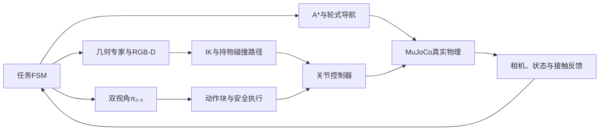

<div align="center">


# Robot VLA

**真实接触移动操作 · 几何规划控制 · 双视角 π₀.₅**

`Husky A200` · `Original UR5` · `Robotiq 2F-85` · `MuJoCo 3.6.0`

[设计推理](docs/DESIGN_REASONING.md) · [成功标准与参数](docs/SUCCESS_CRITERIA_AND_PARAMETERS.md) · [技术总结](docs/TECHNICAL_REPORT.md) · [离线HTML报告](docs/TECHNICAL_REPORT.html) · [问题与解决措施](docs/PROBLEMS_AND_SOLUTIONS.md) · [视频演示](#视频演示) · [运行说明](docs/RUNNING.md) · [实验原始记录](evidence/)
</div>

## 项目概览

在同一个MuJoCo物理系统中完成门操作、十果分类、三书抽屉收纳，并将双视角π₀.₅接入正常机械臂执行器。传统导航/FSM与学习型短技能共存；没有通过物体瞬移、隐藏焊接或被动关节驱动伪造接触操作。

<table><tr><td width="33%"><b>移动与规划</b><br/>A*、外形膨胀、真实轮驱动、Dock与操作驻车</td><td width="33%"><b>接触与操作</b><br/>多初值IK、持物碰撞、推书侧抓、门臂协同</td><td width="33%"><b>视觉语言动作</b><br/>双RGB、实际状态、绝对关节动作、真实后训练与闭环推理</td></tr></table>

## 视频演示

点击封面查看或下载真实连续视频。前三项是完整传统任务开发演示，后三项是驻车指定目标抓起保持；VLA录像没有放置或完整十果分类。演示实例不替代下方固定评测。

<table>
<tr><td width="33%" align="center"><a href="media/demos/door_full.mp4"></a><br/><b>开门 · 入室 · 关门</b><br/>锁边把手 / Oracle / 宽门洞</td><td width="33%" align="center"><a href="media/demos/fruit_full.mp4"></a><br/><b>10果连续分类</b><br/>开发回合 / 全部正确入筐</td><td width="33%" align="center"><a href="media/demos/books_full.mp4"></a><br/><b>三书 · 三层 · 返航</b><br/>120/180/240mm长书本 / Oracle</td></tr>
<tr><td align="center"><a href="media/demos/vla_apple.mp4"></a><br/><b>π₀.₅ 苹果抓取</b></td><td align="center"><a href="media/demos/vla_banana.mp4"></a><br/><b>π₀.₅ 香蕉抓取</b></td><td align="center"><a href="media/demos/vla_orange.mp4"></a><br/><b>π₀.₅ 橘子抓取</b></td></tr>
</table>

[逐段评分与来源](media/index.json)。浏览器不支持直接播放时，可下载MP4后播放。完整材料下载：

- [traditional-cases70.zip](https://github.com/li2311675549/robot-vla/releases/download/v1.0.0/traditional-cases70.zip)
- [vla-cases30.zip](https://github.com/li2311675549/robot-vla/releases/download/v1.0.0/vla-cases30.zip)
- [technical-report-and-evidence.zip](https://github.com/li2311675549/robot-vla/releases/download/v1.0.0/technical-report-and-evidence.zip)

## 架构



VLA只学习驻车机械臂七维动作；门/抽屉约束控制与底盘导航保留传统方案。机身理想RGB-D与腕部虚拟RGB不是完整D435i物理传感器模型。门/抽屉和部分书本使用声明的Oracle几何，接触/容纳评分有仿真辅助。

## 关键问题与解决措施

仅保留五项核心问题，每项按“问题名称—问题分析—采取措施—改进后效果”展开。分析和效果均对应已有实现与记录；未完成的验证明确保留。

### 1. 大书操作失败与异常中断

- **问题名称：** 大书接近和入屉受阻，持书转向时还出现“仍夹着书却中断”的异常。
- **问题分析：** 将失败分为三个层次：①IK有解只证明目标姿态可达，无法证明腕部、相机支架及持物路径有净空；②斜书的轴对齐包围盒外沿不等于实际书边，可能把抓点放到书外；③工具旋转时，世界坐标偏移本来就会改变，直接比较它会误判滑移。由此分别验证几何、执行和监控定义，避免用同一种调参处理不同原因。
- **采取措施：** 先真实推书到桌边，再沿厚度侧抓；采用有向几何确定抓点与支撑余量，选择可行底盘位姿；规划时加入“机器人+随工具运动的书”的完整扫掠，执行已检查路径；滑移改用`R_toolᵀ(p_book−p_tool)`，保留原阈值；入屉前按实际把手/前板碰撞上界留净空并复核屉开度。
- **改进后效果：** 同一时刻的滑移指标由旧世界量25.032mm变为正确工具量2.834mm，双侧接触仍真，定位了该次误报。第三书重新实抓续作完成，抬升92.045mm、最大漂移2.839mm，并完成关屉/返航；该续作不计作新的5m完整回合。公开三尺寸协议随后出现多次完整开发成功，随机散落仍有推移跟踪和路径失败。[修复证据](evidence/issues/third_book_fix.json) · [持物路径证据](evidence/issues/book_swept_path.json)。

### 2. 香蕉有较大接触力仍保持失稳

- **问题名称：** 香蕉抬升后持续漂移或滚转，较大夹持法向力没有保证运输稳定。
- **问题分析：** 稳定抓握同时受接触位置、摩擦和力矩平衡影响。夹爪闭合量是位置命令，增加闭合可能改变曲面接触点和力臂；在固定接触几何下，增加法向力通常仍能提高摩擦上界。满闭合局部回合在底盘几乎未移动时就未通过保持检查，说明该次失败不能仅归于转弯惯性。接触迁移/滚转是证据支持的解释，尚非完整因果证明。
- **采取措施：** 将“建立抓握”和“维持抓握”分开：先闭合形成双侧接触、抬升复核，再调整保持闭合量；同时监测工具坐标相对位移、相对转角和双侧接触。搬运采用限速及轮速渐变，异常持续出现时停止、复核并有界恢复，保持原有材质及评分。
- **改进后效果：** seed420同物理参数局部对照中，满闭合1.0在3.50秒静态保持检查失败；保持0.70完成约0.381m倒车，最大相对漂移18.120→3.038mm、旋转0.15879→0.03992rad。两者从已持物初态开始且持续时间不同，支持保持策略局部有效，不代表等时消融或多种子成功率。[满闭合记录](evidence/issues/banana_full_closure.json) · [保持调节记录](evidence/issues/banana_regulated_hold.json)。

### 3. 开关门频繁重抓与轮臂协调效率低

- **问题名称：** 门把手圆弧超出固定底盘下的舒适操作范围，分段释放、收臂、驻车、重抓造成大量重复操作。
- **问题分析：** 把手运动由铰链约束为圆弧。以门角作为共同进度变量，可以让底盘移动维持机械臂工作空间余量，再由机械臂修正接触位置；底盘实际误差必须进入末端目标计算。持续抓握也会积累接触偏差，因此需要安全退出和重抓条件。关门后的退手同样会影响最终门角，不能只以圆弧轨迹结束作为任务完成。
- **采取措施：** 采用底盘切向运动与机械臂圆弧跟踪协同，根据实测底盘位姿和门角反馈更新目标；正常阶段持续夹持，接触丢失、指垫余量不足、跟踪或碰撞风险触发停车和有限重抓；关门后张爪与沿门法向退手45mm同步，随后独立检查整机入室、关门角及停稳状态。
- **改进后效果：** 同seed2101完整物理回合，闭合边沿36→5次，仿真时间2144.860→462.336秒，约减少86.11%的闭合次数和78.44%的时间。正常门冻结评估10/10，成功均时451.237秒；适用范围为Oracle几何、约1.57m门洞，单回合效率对照不能拆解各子措施的独立贡献。[效率对照](evidence/issues/door_efficiency_comparison.json) · [冻结验收](evidence/issues/door_contact_acceptance.json)。

### 4. 底盘终端Dock振荡与横向残差

- **问题名称：** 接近目标后位置/航向模式反复切换，带载时出现轮速反向或难以消除的横向偏差。
- **问题分析：** 约23mm阈值附近的切换属于离散模式与连续运动耦合问题；载荷缓行逻辑还可能干扰精密转向。滞回能减少抖动，但轮式底盘没有直接横移输入，航向对齐后仅调整角度无法清除横向残差。代码没有积分项，未按“积分饱和”归因，而是分别审查模式切换、轮地响应和局部路径可执行性。
- **采取措施：** 增加进入/退出滞回，分离运输与精密定位模式，限制轮速变化；到位同时检查位姿和实际线/角速度并稳定2秒。对困难横向初态尝试预停靠及运动原语连接，并在相同容差、载荷和预算下比较；无改善的候选保留失败，不作为生产默认。
- **改进后效果：** 严格配对中空载1/10→10/10，带载1/10→6/10，原验收阈值未放宽。模式控制已有改善，通用带载与困难横向工况仍未全部解决；后续重点明确为可执行的局部位姿路径与真实动力学匹配。[详细分析与记录口径](docs/TECHNICAL_REPORT.md#71-dock终端振荡) · [实现](src/robot_exam/tasks/runtime.py)。

### 5. VLA示教动作与部署执行含义不一致

- **问题名称：** 高层关节目标、限速参考及执行器控制量混用，可能使模型训练目标与部署接口错位。
- **问题分析：** `expert.qgoal`、`arm.reference`、`ctrl`处于不同控制时点，分别包含不同的限速历史和重力补偿，不能因维度相同就混为标签。归一化还需匹配实际加权采样和动作chunk，而不是只按文件数量统计。专家重放、loss拟合和模型物理闭环分别检验不同环节，需要分开定位失败。
- **采取措施：** Schema3统一监督为六轴高层绝对关节目标+夹爪，reference/ctrl独立留档；明确观测和动作时间，5Hz预测10步、执行短前缀并重新观测；只用训练分区计算匹配旧20%/新80%采样与10步chunk的统计，按父场景隔离数据分区，固定双相机、检查点、norm和动作映射，通过正常低层控制执行。
- **改进后效果：** 数据、归一化、模型接口及执行链已可追溯，完成真实10000步后训练、检查点保存重载及模型物理抓取实例。闭环仍存在选错目标和抓取失效；格式正确、专家重放和loss下降不能替代模型任务成功率，接触敏感性及失败后分布偏移仍需进一步验证。[实际训练与数据](docs/VLA_DATA_TRAINING.md) · [固定模型验证](evidence/issues/vla_fixed30.json)。

[问题专页](docs/PROBLEMS_AND_SOLUTIONS.md) · [补充数学推导与诊断依据](docs/DESIGN_REASONING.md)。

## 分项案例统计

以下按最终交付资料包逐项统计，每项包含10条记录。传统方法与VLA分别列出，完整任务与单物体操作分别说明。

|方法|操作内容|成功|失败|包内成功占比|
|---|---|---:|---:|---:|
|传统方法|开门、入室、关门完整任务|10|0|100%|
|传统方法|苹果抓取与放置|10|0|100%|
|传统方法|香蕉抓取与放置|9|1|90%|
|传统方法|橘子抓取与放置|10|0|100%|
|传统方法|小书收纳|10|0|100%|
|传统方法|中书收纳|10|0|100%|
|传统方法|大书收纳|7|3|70%|
|VLA|按指令抓取苹果并保持|9|1|90%|
|VLA|按指令抓取香蕉并保持|7|3|70%|
|VLA|按指令抓取橘子并保持|9|1|90%|

> VLA操作范围为指定水果抓起并保持，不包含入筐。

[分项统计与来源摘要](evidence/display_case_summary.json) · [历史固定评测与协议说明](docs/EVALUATION_PROTOCOLS.md)。展示条目平均时间尚未按对应记录重新统计，因此不沿用历史完整任务均时。

本发布目录实际通过258/258本地回归测试（97.29s），另有流式ZIP发布辅助测试1/1通过。日志随证据保存；后续只补文档与归档，不改控制或评分。模块测试、数据重放和loss下降都不等于完整任务通过。

## 任务成功标准

|操作范围|必须满足的核心条件|
|---|---|
|完整开门、入室、关门|真实把手接触开合；关门前整机越过门平面70mm；最终门角绝对值<0.035rad、底盘x>0.70m、整机仍在室内；线速度<0.02m/s、角速度<0.03rad/s，无未处理碰撞或异常|
|传统单水果抓取与放置|抓起目标、搬运并释放；水果全部碰撞包围边界进入正确类别筐，满足现有边界余量与高度范围，水果线速度<0.02m/s|
|完整十果分类|从约5m起点出发，10个水果全部通过上述正确入筐检查，三类均存在，同类有尺寸/外形差异|
|单书收纳|小/中/大按平面面积排序进入第1/2/3层；真实抓放、退出夹爪并关闭该层，书本边界在正确抽屉内且线速度<0.02m/s|
|完整三书收纳返航|三本均在对应层内；各抽屉开度绝对值<12mm；返回初始位置误差<0.10m、航向误差<0.08rad，无未处理碰撞或异常|
|VLA指令抓取保持|抓中指令指定的具体水果；判定时抬升≥55mm，最近1秒双侧接触比例≥90%且末态仍接触；无其他水果抬升≥55mm；旁物保护、驻车和执行检查通过，30仿真秒内完成|

[详细成功标准、评分公式、失败条件与源码](docs/SUCCESS_CRITERIA_AND_PARAMETERS.md)。任务完成、单物体片段与驻车短技能分别按对应操作范围判定。

## 关键控制参数

下列为配置/指令限速，不是全程实测恒定速度。完整参数、阶段覆盖和来源回合见[参数说明](docs/SUCCESS_CRITERIA_AND_PARAMETERS.md#5-底盘与导航参数)及[来源摘要](evidence/task_parameter_sources.json)。

|模块/工况|关键参数|
|---|---|
|物理仿真|步长2ms，500Hz|
|Husky轮式控制|轮半径0.1651m，左右轮距0.555m，四轮目标限幅±12rad/s|
|A*与外形膨胀|栅格0.08m，膨胀半径0.64m|
|空载导航|线速度≤0.20m/s，导航角速度指令限幅±2.0rad/s|
|普通水果转运|线速度≤0.10m/s；普通载荷角速度配置1.0rad/s，上游控制可更低|
|香蕉转运|线速度≤0.05m/s；普通转运角速度配置0.035rad/s，特定纯转向分支可到0.45rad/s|
|新版持书转运|线速度≤0.06m/s；历史大书失败版本也有0.10m/s|
|门臂协同|圆弧参考0.020rad/s；底盘线速度限幅±0.075m/s、角速度±0.85rad/s|
|精密Dock|原调用位置容差；航向<0.035rad、线速度<0.02m/s、角速度<0.03rad/s，稳定2秒|
|VLA驻车保护|位置偏移<10mm、航向偏差<0.020rad；最终稳定状态有效|
|机械臂/VLA执行|传统普通参考限速0.7rad/s、载荷配置1.2rad/s；VLA参考限速0.7rad/s、加速度1.4rad/s²|
|夹爪/模型动作|夹爪归一化0–1；VLA六轴绝对关节目标+夹爪，5Hz预测10步、每次执行1步并重新观测|
|完整任务时间协议|对应开发/冻结回合3000仿真秒、3600墙钟秒；原题无1600秒硬时限，旧默认需由协议配置覆盖|

## VLA数据与训练

- 输入：front/wrist RGB、实测六关节与夹爪、语言；不输入隐藏物体位姿。
- 动作：六关节高层绝对目标+夹爪，5Hz，10步chunk；内部32维填充。
- 实际训练：405片段、25517帧；旧单果20%/新多果80%加权采样。新十果数据为单目标抓取/放置，不是完整十果清空示教。
- 后训练：π₀.₅ LoRA配置，batch4、10000有效更新；最终checkpoint9999，validation flow loss0.01256467。
- norm：只用train，匹配采样和chunk；SHA `2315f953b3ee8949915f315b9c938ef6f0ca7a5e9397562d82c238d90b4c67c8`。
- 学习效果：已有真实抓取实例，尚未证明优于同条件专家或完成学习型完整分类。

[动作接口](docs/VLA_TECHNICAL.md) · [数据与训练](docs/VLA_DATA_TRAINING.md) · [实际服务器源码](server/snapshots/actual_training_20261108/)

## 快速运行

本地仿真使用Python3.10；服务器OpenPI使用独立Python3.11环境。不要把两套依赖混装。

```bash
# 在项目根目录，使用已安装的仿真环境
MUJOCO_GL=egl python -m pytest -q

# 新开发输出；不覆盖已有冻结正式结果
MUJOCO_GL=egl python scripts/run_stage7_isolated.py   --task door --mode oracle --seed 2101 --door-profile aligned_handles_v3   --config configs/door_continuous_contact_frozen_v4.json   --output outputs/new_door_demo --record
```

首次安装参考`requirements.lock.txt`、`environment.yml`和`scripts/setup_env.sh`。VLA推理/训练另需合法权重、Tokenizer、原始数据、对应GPU及独立环境，仓库不会自动下载或启动训练。

## 目录与复现

```text
src/robot_exam/   控制、导航、感知、任务FSM、数据和VLA
scripts/         构建、运行、评估、采数、训练、推理和资料导出
configs/         模型来源、场景、控制器与冻结协议
assets/ scenes/ third_party/   小型模型与原始许可
server/          实际训练源码、OpenPI、锁文件与norm快照
benchmarks/frozen/   三任务原冻结源码及164项SHA核验
media/           代表性连续视频、评分和来源
evidence/        原始统计与问题修复证据
docs/            最终技术总结、问题措施、运行说明
```

模型权重、完整训练数据、虚拟环境、缓存、认证信息和私有开发日记不在仓库中。第三方代码/模型遵循各自许可证；自研根许可证由作者另行确定。这里是MuJoCo仿真工程，不代表真实机器人部署结果。
