<div align="center">
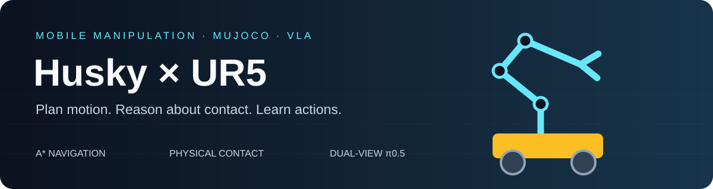

# Robot VLA

**真实接触移动操作 · 几何规划控制 · 双视角 π₀.₅**

`Husky A200` · `Original UR5` · `Robotiq 2F-85` · `MuJoCo 3.6.0`

[从图像到动作](docs/IMPLEMENTATION_GUIDE.md) · [设计推理](docs/DESIGN_REASONING.md) · [成功标准与参数](docs/SUCCESS_CRITERIA_AND_PARAMETERS.md) · [技术总结](docs/TECHNICAL_REPORT.md) · [离线HTML报告](docs/TECHNICAL_REPORT.html) · [问题与解决措施](docs/PROBLEMS_AND_SOLUTIONS.md) · [视频演示](#视频演示) · [运行说明](docs/RUNNING.md) · [实验原始记录](evidence/)
</div>

## 项目概览

**成果展示入口：** [最终交付视频与分项结果](docs/FINAL_RESULTS.md)。下方展示按传统70条、VLA30条交付视频统计；旧固定协议的成功率单独保留为[历史评测档案](docs/EVALUATION_PROTOCOLS.md)，不直接代表当前main版本的新评测结果。

在同一个MuJoCo物理系统中完成门操作、十果分类、三书抽屉收纳，并将双视角π₀.₅接入正常机械臂执行器。传统导航/FSM与学习型短技能共存；没有通过物体瞬移、隐藏焊接或被动关节驱动伪造接触操作。

<table><tr><td width="33%"><b>移动与规划</b><br/>A*、外形膨胀、真实轮驱动、Dock与操作驻车</td><td width="33%"><b>接触与操作</b><br/>多初值IK、持物碰撞、推书侧抓、门臂协同</td><td width="33%"><b>视觉语言动作</b><br/>双RGB、实际状态、绝对关节动作、真实后训练与闭环推理</td></tr></table>

## 任务目标与交付入口

本项目保留三个传统完整任务的成功演示、各自10回合的原始固定评测，以及单独的VLA短技能实验。下面将任务目标与实现、证据对应，完整任务评测与分项展示分别阅读。

|任务目标|实际执行流程|实现与视频|
|---|---|---|
|门外约5m出发，抓把手开门、整机进入并关门|导航→外把手圆弧开门→过门→内把手关门→安全退手|[完整视频](media/demos/door_full.mp4) · [任务源码](src/robot_exam/tasks/door_contact.py) · [历史10回合记录](evidence/formal/door/)|
|距桌约5m出发，将10个随机苹果/香蕉/橘子全部放入对应标识筐|观测剩余物体→多候选抓取→转运→正确入筐复核，循环10件|[完整视频](media/demos/fruit_full.mp4) · [任务源码](src/robot_exam/tasks/fruit.py) · [历史10回合记录](evidence/formal/fruit/)|
|距桌约5m出发，三本不同大小书分层收纳、关屉并返航|面积排序→逐层开屉→回桌推抓→入对应层→关屉→返回保存起点|[完整视频](media/demos/books_full.mp4) · [任务源码](src/robot_exam/tasks/drawer.py) · [历史10回合记录](evidence/formal/books/)|
|可运行代码、模型、环境、视频与技术报告|传统代码/小型模型/许可/依赖随库提供；完整案例附件见Release|[运行说明](docs/RUNNING.md) · [技术报告](docs/TECHNICAL_REPORT.md) · [附件](https://github.com/li2311675549/robot-vla/releases/tag/v1.0.0)|

十果场景三类均包含且同类有尺寸/外形差异，三书使用120/180/240mm长的明显不同尺寸。历史水果布局、新散落三书、正常门Oracle及VLA驻车各自保留协议；[原始完整任务结果](docs/EVALUATION_PROTOCOLS.md)给出成功率、均时和范围，不能由单物体片段替代。VLA复现另需未随库发布的权重、Tokenizer和原始数据。

**阅读路线：** 先看下方架构的感知、动作生成和轮臂配合，再看问题与修复；需要逐函数核对时阅读[完整实现解析](docs/IMPLEMENTATION_GUIDE.md)。

## 视频演示

点击封面查看或下载真实连续视频。前三项是完整传统任务开发演示，后三项是驻车指定目标抓起保持；VLA录像没有放置或完整十果分类。演示实例不替代下方固定评测。

<table>
<tr><td width="33%" align="center"><a href="media/demos/door_full.mp4">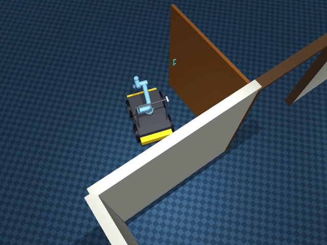</a><br/><b>开门 · 入室 · 关门</b><br/>锁边把手 / Oracle / 宽门洞</td><td width="33%" align="center"><a href="media/demos/fruit_full.mp4">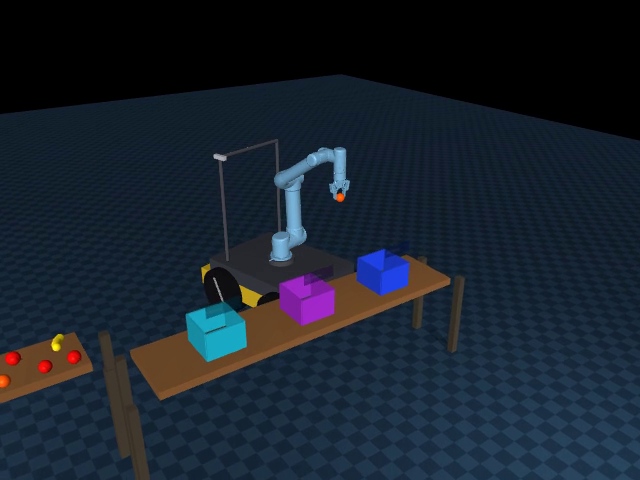</a><br/><b>10果连续分类</b><br/>开发回合 / 全部正确入筐</td><td width="33%" align="center"><a href="media/demos/books_full.mp4">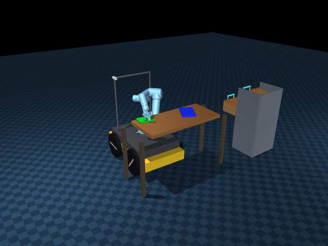</a><br/><b>三书 · 三层 · 返航</b><br/>120/180/240mm长书本 / Oracle</td></tr>
<tr><td align="center"><a href="media/demos/vla_apple.mp4">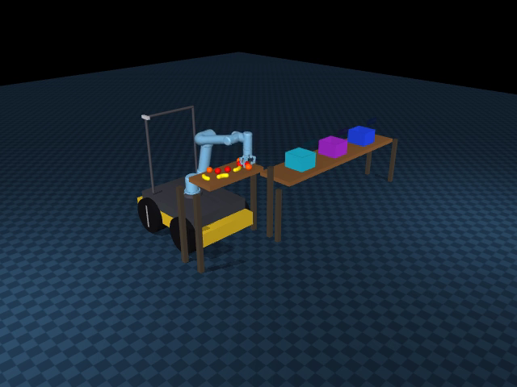</a><br/><b>π₀.₅ 苹果抓取</b></td><td align="center"><a href="media/demos/vla_banana.mp4">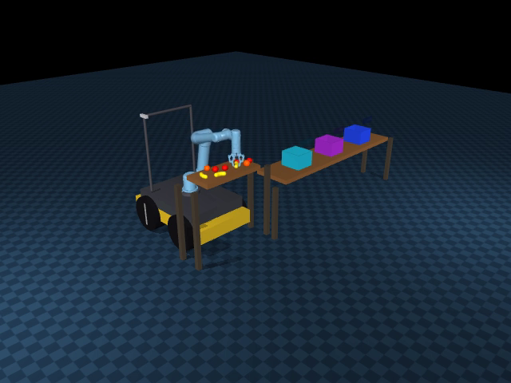</a><br/><b>π₀.₅ 香蕉抓取</b></td><td align="center"><a href="media/demos/vla_orange.mp4">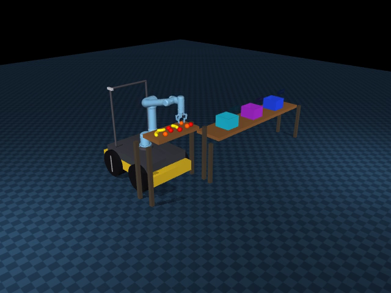</a><br/><b>π₀.₅ 橘子抓取</b></td></tr>
</table>

[逐段评分与来源](media/index.json)。浏览器不支持直接播放时，可下载MP4后播放。完整材料下载：

- [traditional-cases70.zip](https://github.com/li2311675549/robot-vla/releases/download/v1.0.0/traditional-cases70.zip)
- [vla-cases30.zip](https://github.com/li2311675549/robot-vla/releases/download/v1.0.0/vla-cases30.zip)
- [technical-report-and-evidence.zip](https://github.com/li2311675549/robot-vla/releases/download/v1.0.0/technical-report-and-evidence.zip)

## 架构

先区分两个**执行范围不同**的部分：传统系统负责三个完整长程任务；当前VLA只在已驻车桌面上验证“按指令选对水果、抓起并保持”。它们复用机器人与底层控制器，但**当前没有把VLA接入导航、入筐或三项完整任务的调度循环**。

|部分|从哪里开始|由谁生成动作|在哪里结束|
|---|---|---|---|
|传统完整任务|距离门/桌约5m的初始位置|任务步骤调度器调用导航、几何规划和接触技能|门已关闭且整机入室；十果全部正确入筐；三书分层、关屉且返航|
|当前VLA短技能|初始化为已驻车的十果桌面|π₀.₅根据双视角图像、关节状态和语言预测机械臂/夹爪动作|指定水果抓起并保持；不包含底盘导航和入筐放置|

**先理解“任务步骤调度器”。** 它相当于带检查条件的操作清单：知道正在“导航”“抓取”还是“放置”，调用该步技能，检查真实结果后才进入下一步；出错则按上限恢复或结束。在程序里这种组织方式叫**有限状态机（Finite State Machine，FSM）**。“状态”就是当前步骤，“转移”就是满足条件后换到另一步骤；它不是一个负责识图或预测关节动作的神经网络。

下面分三张图阅读，避免把不同范围的执行链混在一张图中。图中实线表示执行顺序/命令与反馈传递；虚线表示满足条件时进入下一轮检查。

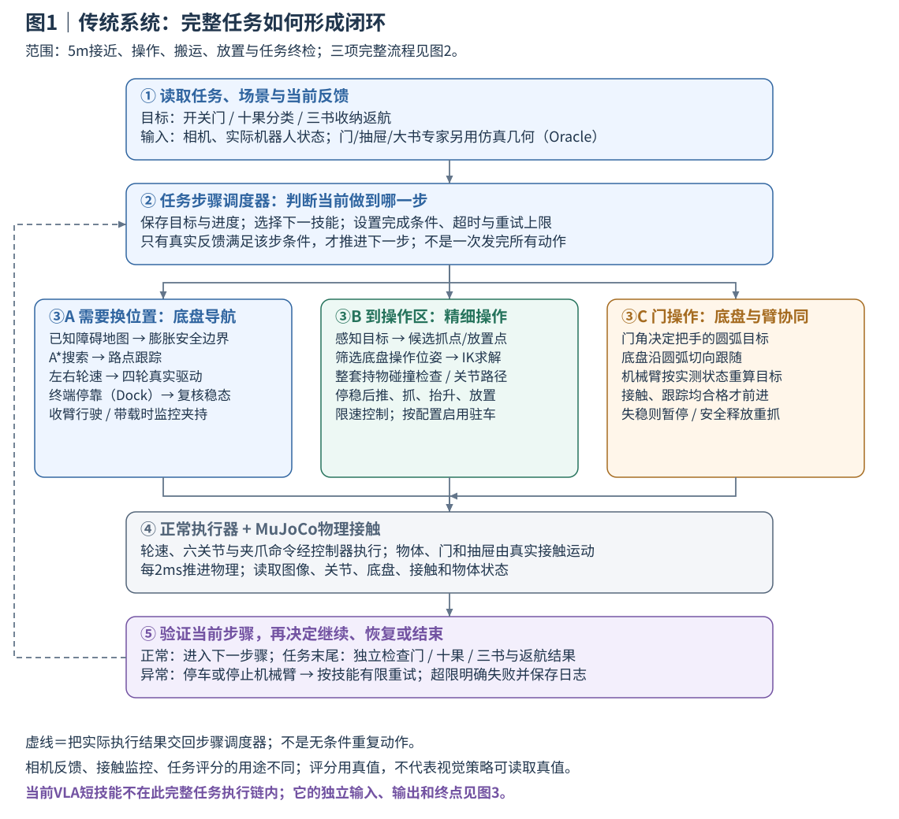

**读图方法：** 从上到下。调度器按当前步骤调用③A、③B或③C；三者是不同动作阶段，不是每一步同时启动三套控制。若③B发现需要换底盘操作位置，就先回到导航与停靠步骤，再按实际停车位姿复算；不是让底盘在精细操作中随意移动。执行器真正动作后，⑤读取结果再反馈给②。图中导航负责“车去哪里”，操作规划负责“手怎么去”，门协同负责“车与手如何一起跟随把手”。

**图中方法与术语：**

|图中术语|初学者可以怎样理解|本项目怎样实现|
|---|---|---|
|机器人状态、位姿|“状态”是测到的关节角、车速等；“位姿”是位置加朝向|底盘用`x、y、yaw`，夹爪目标用三维位置和旋转方向|
|RGB-D、Oracle|RGB是彩色图，D是距离；Oracle是读取仿真几何的专家基线|水果视觉从图像生成目标；当前门、抽屉和大书推抓基线声明使用Oracle；二者信息来源分别报告|
|障碍膨胀、A*、路点跟踪|先把障碍加宽给机器人留空间，再找绕障路线，最后沿路线开车|已知场景栅格上A*搜索路点；位置/航向反馈换算左右轮速。搜索成功不等于实际车已到达|
|终端停靠（Dock）、稳态|“到附近”之后，还要把位置、朝向和实际速度都收敛|达到调用原位置容差、航向≤0.035rad、线速<0.02m/s、角速<0.03rad/s，持续2秒再确认|
|操作位姿、IK|先选择“车停哪里、夹爪指向哪里”；IK反求“六关节各转多少”|检查附近底盘候选与多个关节初值；真实停车后按实际位姿复算，不能只用理论位置|
|整套持物碰撞检查、关节路径|不能只看抓点无碰撞；还要看手、支架、夹住的书在整段移动中会不会撞|检查中间姿态和持物组件；有障碍时用采样搜索连接可行姿态，具体见下文RRT解释|
|MuJoCo、执行器、2ms物理步|MuJoCo是计算机器人和物体运动/碰撞的物理仿真引擎；执行器接收轮速或关节目标|每2ms推进一次动力学。目标命令通过真实轮驱动和夹爪接触改变场景，不用位置重设冒充动作|
|轮臂协同、几何专家|前者是按共同进度协调车与手；后者是按物体形状/机构规则计算动作的程序|门的实际角度同时约束底盘与夹爪；夹持异常则停止推进，而不是各走各的固定轨迹|
|真实接触、双侧接触、反馈|物体靠两指接触力被拿起；双侧接触是左右指都碰到物体；反馈是动作后的实测结果|MuJoCo计算摩擦与碰撞；用相对位移、接触和实际物体状态验证，指令已发送不算成功|
|有限重试、独立终检|失败后只允许限定次数再试；最终再检查整个任务结果|技能按各自策略恢复或明确退出；评分读取物体/门/抽屉真实状态，不把评分真值当视觉输入|

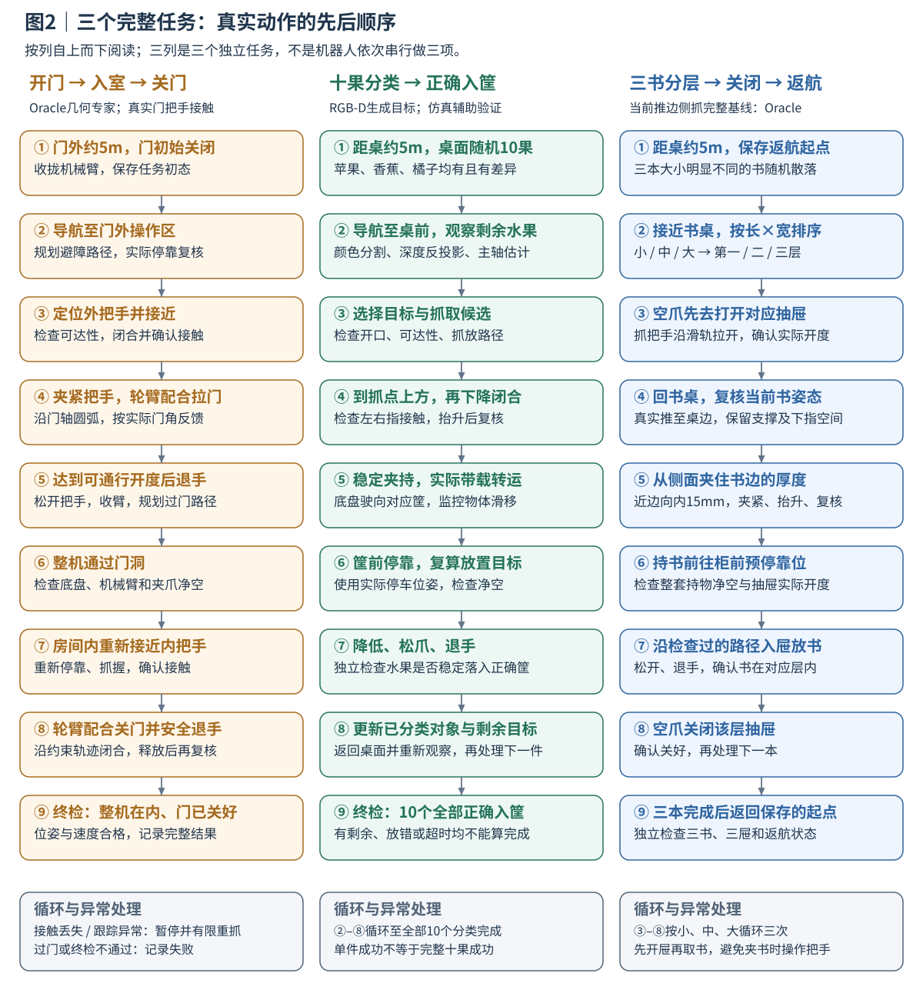

**读图方法：** 每列是一个独立任务，自上而下阅读。水果②–⑧针对剩余目标循环，直到全部10个正确入筐；书本③–⑧按小、中、大执行三次，最后返航。循环失败有次数和超时上限，不是无限重抓。

**图中动作为什么这样安排：**

- **颜色分割、深度反投影、主轴估计：** 先按颜色找水果像素，再用每个像素的深度算三维点；主轴是这些点最伸展的方向，可帮助香蕉选择横向夹持。下文用公式与PCA进一步解释。不是从一张RGB图直接得到精确物体重心。
- **预抓取、闭合、抬升复核：** 先到抓点外的安全位置再靠近；手指合上后，必须真的抬起物体并确认保持，不能把“夹爪已闭合”当作“抓到了”。
- **带载转运：** 指底盘实际携带已抓物体驶向另一操作区。水果通常保持工具世界方向并监控滑移；大书有独立的关节保持与净空检查策略，详见下面轮臂配合表。
- **门的圆弧与抽屉的滑轨：** 把手只能沿门轴绕圈或沿滑轨直线移动，所以动作跟随机构允许运动的方向，而不是硬把夹爪拖到任意空间点。过门后重新接近内把手是另一个操作阶段。
- **推边、侧抓、净空：** 书贴桌时下指进不去；先推到边缘、仍保留桌面支撑，再在书边向内15mm处上下夹住厚度。“净空”是手、支架和书通过时所需的无碰撞空间。抓点与退出路径的具体几何见下文侧抓示意。
- **先开屉再取书、分层后返航：** 两指已夹书时不能同时抓抽屉把手，所以每本书先开对应层，再回桌拿书；放完释放、退手、关该层。大小按平面面积`长×宽`排序，最小/中等/最大对应第一/二/三层，最后回到最初保存的位置。

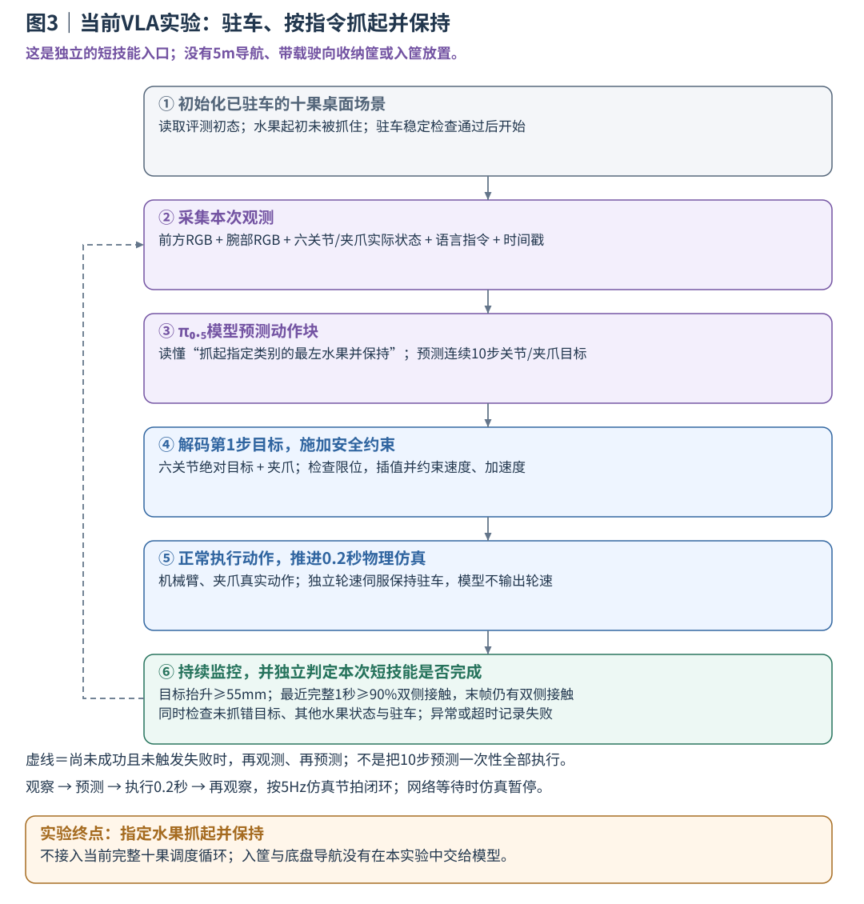

**读图方法：** 进入实验时机器人已经停车；初始化恢复属于场景设置，不是模型完成了5m导航。模型输出只包含六关节目标和夹爪，驻车由独立轮速控制器维持。尚未完成时执行虚线反馈环；成功终点是抓起并保持，图中没有从这个终点继续连到搬运或放置。

|图中术语|具体含义与边界|
|---|---|
|VLA、π₀.₅|VLA是“视觉—语言—动作”模型：看图、读取指令和机器人状态，预测动作；π₀.₅是本项目后训练与评测的具体模型，不是完整导航/任务调度器|
|前方RGB、腕部RGB|机身相机看桌面整体，腕部相机随夹爪观察近处；本模型输入两张彩色图，深度用于传统感知/数据分析，没有拼成模型原生四通道输入|
|六关节绝对目标、夹爪指令|输出六个关节下一步希望达到的角度，加一个归一化开合指令，共7维；“绝对”表示目标角度本身，不是角度增加量，也不是底层力矩|
|动作块、执行第1步、闭环|一次预测10步计划，但只推进第1步对应的0.2秒，再看新图重新预测；不是不看反馈把整段10步盲目执行完|
|限位、插值、速度/加速度约束|超出关节范围的动作不能直接执行；插值把离散目标衔接成受限的高频参考，再送入正常控制器，不能直接改机器人关节状态|
|驻车、5Hz、2ms|驻车通过真实轮速伺服抑制漂移；5Hz指每0.2秒仿真时间更新一次策略，2ms是更底层的物理步长，两种频率含义不同；网络等待时物理暂停|
|抬升与保持评分|目标高于初始位置至少55mm；最近完整1秒至少90%物理步左右指均接触，末帧也有双侧接触；还须通过错抓、其他水果状态、驻车与异常检查，完整条件见成功标准页|

模型输入没有隐藏物体位姿。图3只描述当前已实际评测的抓取阶段；虽然代码保留其他阶段接口，当前材料没有据此声称VLA完成了入筐或完整十果任务。

下面按模块解释公式、动作生成和轮臂配合，供对照三张图进一步阅读。

### 1. 机器人模型与物理执行

- **组成：** Husky提供移动，原版UR5提供六关节操作，2F-85负责开合夹持；机身RGB-D与腕部RGB提供观测。
- **物理：** MuJoCo以2ms步长计算质量、惯量、摩擦和碰撞。4个轮速执行器+6个UR5位置执行器+1个夹爪执行器产生动作；门和抽屉关节被动运动，水果和书本靠真实接触被抓放。

### 2. RGB-D感知：图像怎样变成三维目标

1. **先区分类别和像素区域。** 当前规则视觉按颜色分出苹果、香蕉、橘子或书封面，再用连通域得到各候选物体；这是可控颜色场景的工程基线。
2. **用深度恢复三维位置。** RGB说明像素属于什么物体，Depth给出距离。像素`(u,v)`按`X=(u−cx)D/fx，Y=(v−cy)D/fy，Z=D`还原到相机坐标，再用已知相机外参转换到世界坐标，才能与机械臂目标比较。
3. **估计抓取参考与朝向。** 剔除桌面/工作区外点后，用顶面点的分位数估计XY中心；PCA找出点集最伸展的长轴和垂直短轴，估计长宽。书按`长×宽`排序，香蕉优先沿短轴闭合。估计中心是操作参考，不是精确质量重心。
4. **生成统一目标。** 输出“类别、参考位置、方向、长宽、目标筐”。筐通过颜色标识与已知标识偏移关联，未实现通用文字OCR。

**实际信息来源：** 水果vision分支用RGB-D生成目标；当前大书推抓、门及抽屉成功基线使用明确标注的Oracle（直接读取仿真几何状态的专家），不能把这些真值称为视觉识别结果。VLA只接收双RGB、实际关节/夹爪和语言，不读取隐藏物体位姿。

### 3. 底盘导航：从地面路径到四轮命令

- **找路：** 由已知场景障碍构建0.08m栅格，按整机外形把障碍向外加宽、预留通过空间（障碍膨胀），再做8邻域A*搜索，再简化为避障路点；当前定位反馈来自仿真底盘位姿，没有宣称SLAM。
- **开车：** 路点与当前位姿的误差产生线速度`v`和角速度`ω`，换算左右轮速`ωL=(v−ωb/2)/r，ωR=(v+ωb/2)/r`，其中轮距`b=0.555m`、轮半径`r=0.1651m`。同侧前后轮使用相同目标，实际轮地滑移仍需反馈修正。
- **停稳：** 到操作区域后进入Dock，位置/航向模式采用滞回（默认23mm内进入调航向，误差增至48mm才退出，最终精度仍按23mm）；达到原位置容差、航向和实际速度条件并稳定2秒才确认到位。导航路点半径与最终Dock精度分别设置。

### 4. 操作位姿与IK：决定“车停哪里、手怎么摆”

1. **先生成夹爪目标。** 目标包含位置`p`与方向`R`：同一点从上面抓或侧面抓，会产生不同腕部姿态。水果生成多个主轴方向与小偏移候选，待夹宽度超过78mm的候选先排除；大书使用下面的推边侧抓规则。
2. **再选择底盘操作位置。** 在名义停车点附近枚举小范围候选，检查对应预抓取/抓取或释放/退手目标，按可达性、关节余量、运动代价和碰撞筛选。实际底盘由车轮开过去，停下后按实测位置复算，不能假设理论停车点已精确实现。
3. **IK分配六个关节角。** 正运动学由关节角算夹爪位置；逆运动学反过来给定夹爪位置/方向，求肩、肘、腕各转多少。本项目用雅可比阻尼最小二乘迭代减小末端误差，并从当前角、历史解等多个初值寻找限位内的可行分支。
4. **有解之后还要检查路径。** 需要避障时先检查直接关节路径；受阻后使用RRT（快速随机扩展树）采样可行关节姿态连接路径，并检查各段中间姿态；持书时检查“机械臂+夹爪+支架+随手移动的书”。检查后的路径经平滑插值、参考限速和重力前馈写入执行器，结束后读取真实关节/TCP误差。TCP是夹爪的`grip_pinch`参考点，不是腕关节中心。

求出IK只得到目标关节角，不表示物体已被抓住，也不表示实际路径已通过。

### 5. 动作怎样生成：水果、书本、门与抽屉

**水果抓放**由几何专家串联：观察→选目标→到抓点上方85mm预抓取→下降→闭合并检查双侧接触→抬升→带载转运→降低到对应筐→松开退手→检查真实落点。香蕉候选还考虑主轴方向与邻近抓点；物理夹持是否稳定由接触和相对位姿验证。

**大书为什么先推？** 240×160×25mm书的整宽超出夹爪开口，25mm厚度却可夹。完全贴桌时下指没有进入书底的空间，先推到桌边露出一段，才能从侧面进入并用上下两指夹住厚度。

**大书具体抓哪里？** 当前Oracle专家从书的远侧向机器人方向（−x）反馈推移，保留桌面支撑；默认选择露出近边**往书内15mm的边缘中段**，预抓取点在其外侧75mm。抓点高度跟随实际书中心，闭合方向竖直。斜书按真实有向截面计算边缘，最大书另有长边法向候选，不满足支撑条件时回退并重新检查。

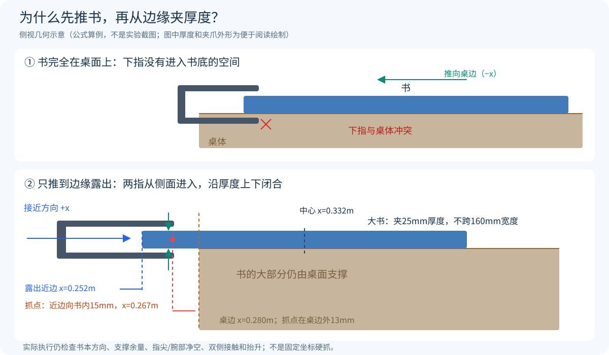

当前桌边`x=0.280m`、近边反馈目标`x≤0.252m`、抓点必须`x≤0.270m`。例如对齐算例中，近边0.252m，向内15mm抓点为0.267m，仍在桌边外13mm；这是公式算例，不是新增实验。真实顺序为推边→退手/退底盘→张爪侧向接近→闭合→指令抬升100mm→验证实际抬升>55mm及保持状态。

**门与抽屉**按机构约束生成目标：门把手沿门轴圆弧，底盘切向跟随、机械臂用实测门角修正；抽屉把手沿滑轨直线，通过夹爪真实拉开/推回，以实际开度确认。门轴和抽屉没有隐藏驱动器替机器人动作。

### 6. 决策与轮臂配合：每一阶段由谁运动

传统完整任务采用FSM（有限状态机）：程序按当前阶段调用技能，读取物理完成条件后才切换；超时或接触异常进入有限恢复。它不会因一段轨迹执行结束就直接宣布任务成功。

|阶段|底盘|机械臂/夹爪|协调依据|
|---|---|---|---|
|5m接近|按A*路点行驶|收拢保持|先到操作区域，再进行精细动作|
|驻车推抓/放置|启用驻车配置时保持锚点|推、抓、放|稳定2秒后开始，漂移超限停止|
|水果带载转运|按物体类别限速行驶|默认每20ms重算IK以保持工具世界方向|夹爪位置随车走，方向尽量不随底盘转向扭转；继续检测滑移|
|最大书特定转运|低速移至柜前预停靠|保持关节姿态、检查整套持物净空后抬高接近|不把水果的方向保持规则强加到大书；仍检查夹持与路径|
|持续开/关门|沿门弧跟随|跟踪实际把手并保持接触|门角作为共同进度，接触/跟踪异常暂停或安全重抓|

独立VLA实验不属于上表的完整任务步骤：它在已驻车状态下由模型控制机械臂/夹爪，底盘由独立驻车伺服保持。

驻车由真实轮速伺服修正漂移，不锁死底盘自由基座；转运前解除驻车，下一处操作前重新检查稳定。

书本任务会**先去打开对应抽屉，再回桌拿书**，避免两指已夹书时还要抓把手。放书前复核实际开度，放后退手关屉，三本完成后返回保存的起点。水果每放完一个再观察剩余物体。历史回合是否启用驻车保护以其配置为准。

### 7. VLA如何生成动作及如何训练

- **学习：** 几何专家提供成功示教，π₀.₅经LoRA（只训练附加的低秩小参数，减少训练开销）后训练，从front/wrist RGB、实际六关节/夹爪状态和语言直接预测六轴绝对关节目标+夹爪动作。数据同步记录并按场景分区，归一化统计norm（把各状态/动作维度缩放到便于学习的范围）只使用训练集并匹配采样分布。
- **执行：** 按5Hz仿真节拍预测10步动作块，执行1步0.2秒后重新观测；限位、插值、速度与加速度约束在正常控制接口完成，不由几何专家代替模型抓取。网络等待时仿真暂停，不宣称实体实时部署。

VLA当前验证范围是驻车指定水果抓起保持；传统系统保留导航、门/抽屉与完整任务调度。虚拟相机模拟对应RGB-D/RGB观测能力，不是完整D435i物理传感器模型。

[实现解析：公式、抓点、决策与代码](docs/IMPLEMENTATION_GUIDE.md) · [成功标准与参数](docs/SUCCESS_CRITERIA_AND_PARAMETERS.md) · [完整技术报告](docs/TECHNICAL_REPORT.md)

## 关键问题与解决措施

按“具体故障→原因证据→原方案改动→实际效果”梳理六项核心问题；同一物体的抓取策略问题与监控误报分别分析。

### 1. 第三本书仍夹在手中，却被滑移保护中断

- **问题名称：** 持书转向时，书没有掉落，程序却报`gripper_slip`，中断放置。
- **问题分析：** 原检测比较世界坐标向量`p_book−p_tool`与初始值的差。夹爪转向时，书随夹爪正常转动，该向量也旋转；边缘夹持的中心偏置较大，正常转动足以越过25mm阈值。同一时刻旧量25.032mm、工具坐标量2.834mm、双侧接触仍真，确认是检测坐标错误，而非录像漏看了掉落。
- **采取措施：** 将抓取初始参考与后续采样统一为`r=R_toolᵀ(p_book−p_tool)`，比较工具坐标中的偏移；相对旋转也使用相同坐标约定。原25mm/0.35rad阈值、连续3次20ms异常规则及双侧接触检查全部保留。修改点为`relative_grasp_pose()`和`TaskRuntime.tick()`，没有靠调大阈值消除报警。
- **改进后效果：** 修复后越过原误报点，第三书从检查点重新实抓完成搬运、入屉、关屉和返航，抬升92.045mm、最大工具坐标漂移2.839mm。这证明该监控修复及后半链路有效；它不是新增5m完整三书回合。[同帧证据与续作](evidence/issues/third_book_fix.json)。

### 2. 大书受桌面阻挡，夹住后又撞抽屉把手

- **问题名称：** 大书接近/下降误差大，腕部碰桌；持书入屉前又与把手、前板碰撞。
- **问题分析：** 三处原因需要分别处理：①普通上方夹取受平面宽度与开口限制；转侧抓后，下指仍没有进入贴桌书底的空间。②斜书的AABB角点不在真实中线书边上，曾令抓点落在书外约13mm。③持书后外形变大，仅检查机械臂本体或前板高度会漏掉书、支架和凸出把手。原记录有下降误差约67.4mm、A4候选腕/掌穿桌约41.7mm，不能用IK有解作为动作可执行证明。
- **采取措施：** 原“直接从上方接近夹取”改为“真实推到桌边→复核支撑→侧向进入→上下夹厚度”，默认抓近边向内15mm处、预抓取后退75mm；抓点用有向几何重算。原机器人本体碰撞检查扩展为整个持物组件的扫掠，并执行已检查路径；柜前提前检查组件最低点，按实际把手/前板上界另留40mm，再复核实际屉开度和释放/退手路径。
- **改进后效果：** 120×80×15、180×120×20、240×160×25mm三尺寸协议已有多个完整开发成功回合。历史冻结散落协议记录为4/10，包含5次推书跟踪、1次持物路径预检失败；用于该阶段问题诊断，不作为当前main版本的新评测成绩。A4探索与该三尺寸协议分开，不把尺寸变更当作控制器同条件提升。[几何修复](evidence/issues/book_geometry.json) · [持物路径](evidence/issues/book_swept_path.json) · [冻结结果](evidence/issues/books_formal_summary.json)。

### 3. 香蕉已经抬起，仍在两指间缓慢滚转

- **问题名称：** 初次抬升通过后，香蕉在保持或搬运中发生相对滑移和转动。
- **问题分析：** 离桌只表示桌面不再托住物体，重力仍作用在质心；接触点与质心之间有力臂，夹持还须平衡力矩。两指接触不是刚性固定，45N/44N法向力合计也不代表抗转动能力足够。满闭合局部回合在底盘几乎不动时就出现位移/转角增长并保持失败，说明该次失败不是由转弯才触发。已确认持续保持阶段失稳，接触点各自的力矩贡献尚未完成定量分解。
- **采取措施：** 原“抓起后一直满闭合1.0”改为“建立双侧接触→抬升复核→保持闭合0.70→持续复核相对位姿与接触”。闭合量是位置命令，不是70N或摩擦系数。低速、轮速渐变用于限制运输扰动；持续超限时停车复核并有界恢复，未提高材质摩擦或执行器力上限。
- **改进后效果：** seed420已持物对照中，1.0保持在3.50秒静态检查失败；0.70保持完成约0.381m倒车，最大漂移18.120→3.038mm、转角0.15879→0.03992rad。两者持续时间不同，支持该局部控制有效，不作为等时消融或所有香蕉的成功率。[满闭合](evidence/issues/banana_full_closure.json) · [保持调节](evidence/issues/banana_regulated_hold.json)。

### 4. 开门反复重抓，关门退出时又拖动把手

- **问题名称：** 分段开门每段都松手、收臂、移动、重抓；关门后退出仍会改变门角。
- **问题分析：** 把手沿门轴圆弧运动，固定底盘跟完整圆弧会消耗机械臂可达余量。原方法通过重抓回避这一约束，但增加重复定位与接触重建。关门后，直接张爪也不等于手指已脱离把手，退手方向会产生额外接触。
- **采取措施：** 用共同门角生成底盘切向路径与把手目标，根据实际底盘和门角反馈修正；参考进度只在接触、工具误差和底盘误差合格时前进。正常持续夹紧，触发安全条件才停车并有限重抓。退出改为逐渐张爪同时沿门法向退45mm，再独立复核门角、整机入室和停稳。
- **改进后效果：** 同seed2101完整回合，夹爪闭合边沿36→5，时间2144.860→462.336仿真秒，分别减少86.11%和78.44%。正常门冻结10/10，平均451.237秒；范围是Oracle几何和约1.57m门洞，各子措施独立贡献未另做消融。[效率对照](evidence/issues/door_efficiency_comparison.json) · [冻结验收](evidence/issues/door_contact_acceptance.json)。

### 5. 带载底盘到目标附近，却反复调姿停不稳

- **问题名称：** 携果staging Dock超时，位置和航向控制反复切换。
- **问题分析：** 原控制在同一距离阈值切换模式，约23mm附近波动就反向输出；载荷缓行还会在调航向时引入位移。滞回解决切换抖动，但不能消除独立的横向残差：底盘没有直接横移输入，须通过前进/后退和转向组合修正。代码没有积分项，因此不归于积分饱和。
- **采取措施：** 默认23mm容差下，进入航向模式为23mm、退出为48mm，最终23mm精度不变；精密Dock与载荷缓行分开，轮速限变化率。将瞬时位姿到位改为位姿合格、线速度<0.02m/s、角速度<0.03rad/s并稳定2秒；困难横向初态另试预停靠与运动原语，不启用无改善候选为默认。
- **改进后效果：** 严格配对空载1/10→10/10、带载1/10→6/10，原阈值未放宽。模式切换改善已验证，带载横向工况仍未全部解决，需要进一步匹配局部路径与真实轮地响应。[原始对比口径](docs/TECHNICAL_REPORT.md#71-dock终端振荡) · [实现](src/robot_exam/tasks/runtime.py)。

### 6. VLA会抓取，但十果场景中的指定目标抓取不稳定

- **问题名称：** 历史固定验证中出现指定目标未抬起或抓错同类水果。
- **问题分析：** 历史固定30回合为14成功、16失败：15次目标最大抬升不足10mm，1次抓错指令指定的最左目标。它定位到“目标选择/有效抬升”环节，不能全部写成搬运掉落，也不能仅由loss推出训练充分。检查点、相机和norm已核验，但15次低抬升还未被因果分解为定位、接近、闭合或接触中的单一根因；部分初始化的源专家本身也失败，进一步配对必须保留几何难例这一因素。
- **采取措施：** 已把指令和评分绑定到具体目标、保留全部30回合，并记录各物体抬升、目标接触和动作，拆分15次低抬升与1次错目标。下一步尚未执行：在同一初态配对专家/模型，逐段比较接近误差、闭合时机、双侧接触和抬升；按实际失败补相应阶段示教，再用新独立布局评测。十果训练中的91次父操作是单目标操作，不能当作91次完整清空任务。
- **改进后效果：** 已完成真实10000步后训练及多类水果物理抓取实例；该历史诊断明确了16次失败分布，本次文档更新未产生新训练版本或成功率提升。历史固定14/30与最终交付视频构成分别保留，不能用补录成功替代新独立验证。[逐回合诊断](evidence/issues/vla_fixed30.json) · [数据覆盖](docs/VLA_DATA_TRAINING.md)。

[问题专页](docs/PROBLEMS_AND_SOLUTIONS.md) · [补充推导](docs/DESIGN_REASONING.md)

## 分项案例统计

以下按最终交付资料包逐项统计，每项包含10条记录。记录经选取，含重复初态和不同开发版本，比例为视频包内成功占比，不是连续独立十回合成功率。门为完整任务；水果和书本主要为单项片段，香蕉与大书分组还含局部失败诊断。详见[统一成果说明](docs/FINAL_RESULTS.md)。

|方法|操作内容|成功|失败|视频包内成功占比|
|---|---|---:|---:|---:|
|传统方法|开门、入室、关门完整任务|10|0|100%|
|传统方法|苹果抓取与放置|10|0|100%|
|传统方法|香蕉抓取与放置|9|1|90%|
|传统方法|橘子抓取与放置|10|0|100%|
|传统方法|小书收纳|10|0|100%|
|传统方法|中书收纳|10|0|100%|
|传统方法|大书收纳|7|3|70%|
|VLA|按指令抓取苹果并保持|9|1|90%|
|VLA|按指令抓取香蕉并保持|7|3|70%|
|VLA|按指令抓取橘子并保持|9|1|90%|

> VLA操作范围为指定水果抓起并保持，不包含入筐。

[分项统计与来源摘要](evidence/display_case_summary.json) · [历史固定评测与协议说明](docs/EVALUATION_PROTOCOLS.md)。展示条目平均时间尚未按对应记录重新统计，因此不沿用历史完整任务均时。

本轮公开源码完整回归 **259/259通过（96.85s）**，另完成5项数学核对、3场景短步进及独立IK校核。[检查方法、首次环境失败与复核日志](docs/VALIDATION.md)均保留。这些验证不替代完整任务成功率，本轮没有新训练或更改评分。

## 任务成功标准

|操作范围|必须满足的核心条件|
|---|---|
|完整开门、入室、关门|真实把手接触开合；关门前整机越过门平面70mm；最终门角绝对值<0.035rad、底盘x>0.70m、整机仍在室内；线速度<0.02m/s、角速度<0.03rad/s，无未处理碰撞或异常|
|传统单水果抓取与放置|抓起目标、搬运并释放；水果全部碰撞包围边界进入正确类别筐，满足现有边界余量与高度范围，水果线速度<0.02m/s|
|完整十果分类|从约5m起点出发，10个水果全部通过上述正确入筐检查，三类均存在，同类有尺寸/外形差异|
|单书收纳|小/中/大按平面面积排序进入第1/2/3层；真实抓放、退出夹爪并关闭该层，书本边界在正确抽屉内且线速度<0.02m/s|
|完整三书收纳返航|三本均在对应层内；各抽屉开度绝对值<12mm；返回初始位置误差<0.10m、航向误差<0.08rad，无未处理碰撞或异常|
|VLA指令抓取保持|抓中指令指定的具体水果；判定时抬升≥55mm，最近1秒双侧接触比例≥90%且末态仍接触；无其他水果抬升≥55mm；旁物保护、驻车和执行检查通过，30仿真秒内完成|

[详细成功标准、评分公式、失败条件与源码](docs/SUCCESS_CRITERIA_AND_PARAMETERS.md)。任务完成、单物体片段与驻车短技能分别按对应操作范围判定。

## 关键控制参数

下列为配置/指令限速，不是全程实测恒定速度。完整参数、阶段覆盖和来源回合见[参数说明](docs/SUCCESS_CRITERIA_AND_PARAMETERS.md#5-底盘与导航参数)及[来源摘要](evidence/task_parameter_sources.json)。

|模块/工况|关键参数|
|---|---|
|物理仿真|步长2ms，500Hz|
|Husky轮式控制|轮半径0.1651m，左右轮距0.555m，四轮目标限幅±12rad/s|
|A*与外形膨胀|栅格0.08m，膨胀半径0.64m|
|空载导航|线速度≤0.20m/s，导航角速度指令限幅±2.0rad/s|
|普通水果转运|线速度≤0.10m/s；普通载荷角速度配置1.0rad/s，上游控制可更低|
|香蕉转运|线速度≤0.05m/s；普通转运角速度配置0.035rad/s，特定纯转向分支可到0.45rad/s|
|新版持书转运|线速度≤0.06m/s；历史大书失败版本也有0.10m/s|
|门臂协同|圆弧参考0.020rad/s；底盘线速度限幅±0.075m/s、角速度±0.85rad/s|
|精密Dock|原调用位置容差；航向<0.035rad、线速度<0.02m/s、角速度<0.03rad/s，稳定2秒|
|VLA驻车保护|位置偏移<10mm、航向偏差<0.020rad；最终稳定状态有效|
|机械臂/VLA执行|传统普通参考限速0.7rad/s、载荷配置1.2rad/s；VLA参考限速0.7rad/s、加速度1.4rad/s²|
|夹爪/模型动作|夹爪归一化0–1；VLA六轴绝对关节目标+夹爪，5Hz预测10步、每次执行1步并重新观测|
|完整任务时间协议|对应开发/冻结回合3000仿真秒、3600墙钟秒；原题无1600秒硬时限，旧默认需由协议配置覆盖|

## VLA数据与训练

- 输入：front/wrist RGB、实测六关节与夹爪、语言；不输入隐藏物体位姿。
- 动作：六关节高层绝对目标+夹爪，5Hz，10步chunk；内部32维填充。
- 实际训练：405片段、25517帧；旧单果20%/新多果80%加权采样。新十果数据为单目标抓取/放置，不是完整十果清空示教。
- 后训练：π₀.₅ LoRA配置，batch4、10000有效更新；最终checkpoint9999，validation flow loss0.01256467。
- norm：只用train，匹配采样和chunk；SHA `2315f953b3ee8949915f315b9c938ef6f0ca7a5e9397562d82c238d90b4c67c8`。
- 学习效果：已有真实抓取实例，尚未证明优于同条件专家或完成学习型完整分类。

[动作接口](docs/VLA_TECHNICAL.md) · [数据与训练](docs/VLA_DATA_TRAINING.md) · [实际服务器源码](server/snapshots/actual_training_20261108/)

## 快速运行

本地仿真使用Python3.10；服务器OpenPI使用独立Python3.11环境。不要把两套依赖混装。

```bash
# 在项目根目录，使用已安装的仿真环境
MUJOCO_GL=egl python -m pytest -q

# 新开发输出；不覆盖已有冻结正式结果
MUJOCO_GL=egl python scripts/run_stage7_isolated.py   --task door --mode oracle --seed 2101 --door-profile aligned_handles_v3   --config configs/door_continuous_contact_frozen_v4.json   --output outputs/new_door_demo --record
```

首次安装参考`requirements.lock.txt`、`environment.yml`和`scripts/setup_env.sh`。VLA推理/训练另需合法权重、Tokenizer、原始数据、对应GPU及独立环境，仓库不会自动下载或启动训练。

## 目录与复现

```text
src/robot_exam/   控制、导航、感知、任务FSM、数据和VLA
scripts/         构建、运行、评估、采数、训练、推理和资料导出
configs/         模型来源、场景、控制器与冻结协议
assets/ scenes/ third_party/   小型模型与原始许可
server/          实际训练源码、OpenPI、锁文件与norm快照
benchmarks/frozen/   三任务原冻结源码及164项SHA核验
media/           代表性连续视频、评分和来源
evidence/        原始统计与问题修复证据
docs/            最终技术总结、问题措施、运行说明
```

模型权重、完整训练数据、虚拟环境、缓存、认证信息和私有开发日记不在仓库中。第三方代码/模型遵循各自许可证；自研根许可证由作者另行确定。这里是MuJoCo仿真工程，不代表真实机器人部署结果。
