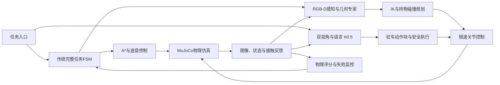

<div align="center">


# Robot VLA

**真实接触移动操作 · 几何规划控制 · 双视角 π₀.₅**

`Husky A200` · `Original UR5` · `Robotiq 2F-85` · `MuJoCo 3.6.0`

[设计推理](docs/DESIGN_REASONING.md) · [成功标准与参数](docs/SUCCESS_CRITERIA_AND_PARAMETERS.md) · [技术总结](docs/TECHNICAL_REPORT.md) · [离线HTML报告](docs/TECHNICAL_REPORT.html) · [问题与解决措施](docs/PROBLEMS_AND_SOLUTIONS.md) · [视频演示](#视频演示) · [运行说明](docs/RUNNING.md) · [实验原始记录](evidence/)
</div>

## 项目概览

在同一个MuJoCo物理系统中完成门操作、十果分类、三书抽屉收纳，并将双视角π₀.₅接入正常机械臂执行器。传统导航/FSM与学习型短技能共存；没有通过物体瞬移、隐藏焊接或被动关节驱动伪造接触操作。

<table><tr><td width="33%"><b>移动与规划</b><br/>A*、外形膨胀、真实轮驱动、Dock与操作驻车</td><td width="33%"><b>接触与操作</b><br/>多初值IK、持物碰撞、推书侧抓、门臂协同</td><td width="33%"><b>视觉语言动作</b><br/>双RGB、实际状态、绝对关节动作、真实后训练与闭环推理</td></tr></table>

## 视频演示

点击封面查看或下载真实连续视频。前三项是完整传统任务开发演示，后三项是驻车指定目标抓起保持；VLA录像没有放置或完整十果分类。演示实例不替代下方固定评测。

<table>
<tr><td width="33%" align="center"><a href="media/demos/door_full.mp4"></a><br/><b>开门 · 入室 · 关门</b><br/>锁边把手 / Oracle / 宽门洞</td><td width="33%" align="center"><a href="media/demos/fruit_full.mp4"></a><br/><b>10果连续分类</b><br/>开发回合 / 全部正确入筐</td><td width="33%" align="center"><a href="media/demos/books_full.mp4"></a><br/><b>三书 · 三层 · 返航</b><br/>120/180/240mm长书本 / Oracle</td></tr>
<tr><td align="center"><a href="media/demos/vla_apple.mp4"></a><br/><b>π₀.₅ 苹果抓取</b></td><td align="center"><a href="media/demos/vla_banana.mp4"></a><br/><b>π₀.₅ 香蕉抓取</b></td><td align="center"><a href="media/demos/vla_orange.mp4"></a><br/><b>π₀.₅ 橘子抓取</b></td></tr>
</table>

[逐段评分与来源](media/index.json)。浏览器不支持直接播放时，可下载MP4后播放。完整材料下载：

- [traditional-cases70.zip](https://github.com/li2311675549/robot-vla/releases/download/v1.0.0/traditional-cases70.zip)
- [vla-cases30.zip](https://github.com/li2311675549/robot-vla/releases/download/v1.0.0/vla-cases30.zip)
- [technical-report-and-evidence.zip](https://github.com/li2311675549/robot-vla/releases/download/v1.0.0/technical-report-and-evidence.zip)

## 架构

系统采用**传统完整任务控制 + VLA驻车短技能**两条执行路径，共用机器人模型、相机和底层执行器。



### 1. 物理仿真与机器人执行

- **建模：** 在MuJoCo中装配Husky、原版UR5和2F-85，为车轮、机械臂、门轴、抽屉及物体配置关节、碰撞、质量、惯量和摩擦，物理步长为2ms。
- **执行：** 底盘由四轮速度执行器驱动，机械臂采用关节位置执行器和重力前馈，夹爪通过真实接触操作自由物体；仿真提供图像、关节状态和接触记录。

### 2. RGB-D感知与目标表示

- **定位原理：** 用颜色阈值和连通域分出物体像素，通过相机内参将像素与深度反投影为三维点，再利用相机外参转换到统一世界坐标。
- **几何估计：** 对点集做PCA估计长轴方向和长宽，为水果生成类别与抓取方向，为书本计算平面面积并排序；收纳筐通过类别标识及已知标识到筐的变换关联。门、抽屉及部分书本采用明确标注的Oracle几何。

### 3. A*导航、差速跟踪与终端停车

- **路径规划：** 根据已知场景障碍构建二维栅格，按整机外形膨胀障碍，使用8邻域A*搜索、回溯和可见性简化获得避障路点。
- **底盘控制：** 读取仿真底盘位姿反馈，按路点位置/航向误差计算线速度`v`和角速度`ω`，再转换为左右轮速。末端Dock采用位置/航向模式滞回和实测速度判定，连续稳定2秒后确认到位；驻车操作阶段持续监测漂移。

### 4. 操作位姿、IK与机械臂路径

- **可达性：** 为抓取/放置生成多个末端姿态和邻近底盘操作位姿；用雅可比阻尼最小二乘IK，从当前关节、历史解及不同初值求解，再按关节余量、移动代价和碰撞筛选。
- **轨迹执行：** 需要避障的动作使用关节空间RRT与分段碰撞检查；持书时把实际夹持偏置带入“机器人+书本”扫掠。路径经平滑插值、参考限速和重力前馈送入执行器，并检查实际关节/TCP到位误差。

### 5. 真实接触操作技能

- **水果与书本：** 水果执行接近、闭合、抬升、搬运、释放与入筐复核；大书采用推到桌边后沿厚度侧抓。搬运中用双侧接触及工具坐标相对位姿检测滑移。
- **门与抽屉：** 门按实测门角生成把手圆弧，并协调底盘移动与机械臂跟踪；抽屉沿滑轨方向通过夹爪接触推拉，以实际开度验证进度。动作均由机器人接触产生。

### 6. FSM任务调度与失败恢复

- **任务组织：** 通过导航、观察、选目标、规划、接近、抓取、操作、放置、验证及返航等状态串联完整任务；每个状态明确输入、完成条件、超时和重试上限。
- **闭环验证：** 感知和控制完成后，再按物体是否入正确筐/抽屉、门角、抽屉开度和返航误差独立评分。失败记录原始原因、状态和截图，仅在预算内执行重观测、重抓或重新规划。

### 7. VLA学习、数据与动作执行

- **学习原理：** 用几何专家的成功轨迹进行π₀.₅ LoRA后训练；输入前方/腕部RGB、实际六关节与夹爪状态、语言指令，学习输出六轴绝对关节目标和夹爪动作。示教同步保存状态、动作与图像，按场景划分数据，仅用训练集计算匹配采样的归一化统计。
- **闭环执行：** 按5Hz仿真控制节拍预测10步动作块，每次执行1步并重新观测；经过插值、关节限位、速度/加速度约束后交给同一底层控制器。当前VLA验证范围为驻车指令抓起保持；底盘导航、门/抽屉和完整任务调度保留传统控制。

**信息来源与范围：** 机身理想RGB-D和腕部虚拟RGB用于对应观测功能，不是完整D435i传感器物理模型；Oracle控制与视觉控制分别标注，仿真接触/真值用于监控和独立评分，VLA观测不输入隐藏物体位姿。

[成功标准与关键参数](docs/SUCCESS_CRITERIA_AND_PARAMETERS.md) · [完整技术报告与源码索引](docs/TECHNICAL_REPORT.md)

## 关键问题与解决措施

按具体故障分为六项，每项明确原因定位、原方案改动和实际结果。大书的监控误判与抓取策略分别说明；VLA重点说明当前真实抓取失败，不再单列动作接口问题。

### 1. 第三本书仍被夹住，却被滑移检测误判为掉落风险

- **问题名称：** 机器人持书转向时，书仍在两指之间，程序却触发`gripper_slip`并中断后续放置。
- **问题分析：** 原判据比较世界坐标偏移`p_book−p_tool`与抓取初始值的差，超过25mm连续3次就停止。工具转向后，正常夹持的书会随工具一起旋转，这个世界向量也随之旋转，检测器将正常转动计入“滑移”。同一触发时刻，旧指标25.032mm、工具局部指标2.834mm，且双侧接触为真，直接定位到检测坐标系错误。
- **采取措施：** 将初始参考和运行中测量统一改为工具坐标：`r=R_toolᵀ(p_book−p_tool)`，比较`r(t)−r(0)`；相对旋转也在工具坐标计算。具体实现为`control/grasp_monitor.py::relative_grasp_pose()`及`TaskRuntime.tick()`的载荷监控。25mm平移阈值、0.35rad转角阈值、连续3个20ms采样及双侧接触检查全部保留；没有通过放宽阈值消除报警。
- **改进后效果：** 原误报点被正确通过。第三书重新实抓的检查点续作完成抬升、搬运、入屉、关屉与返航，抬升92.045mm、最大工具坐标漂移2.839mm。该结果验证了误报修复及后半操作链，不记作新的5m完整三书回合。[同帧诊断与续作记录](evidence/issues/third_book_fix.json)。

### 2. 大书从上方接近时受桌面限制，抓住后又与柜体碰撞

- **问题名称：** 大书预抓取/下降不到位，腕部或相机支架碰桌；持书接近抽屉时，书又撞到凸出的把手或前板。
- **问题分析：** 原策略沿用从桌面上方接近、直接夹取的动作链。大书的平面宽度与夹爪开口、桌面净空不匹配，求出末端IK解仍不能让手腕和指尖穿过桌面。已有下降误差约67.4mm、A4候选腕/掌穿桌约41.7mm。持书后，碰撞外形从机械臂变为“机械臂+书”；仅检查机器人本体或抽屉前板高度会漏掉书和凸出把手。斜书还存在按AABB外沿选点、抓点落在实际书外约13mm的问题。
- **采取措施：** 抓取从“上方直接接近夹取”改为“真实推到桌边→检查支撑与下方净空→沿书厚侧抓→垂直抬升”；抓点由AABB外沿改为有向书本真实截面。搬运从“只检查机器人本体”改为“按实际夹持偏置检查机器人与书的完整扫掠”，并执行已验路径。入屉高度按实际前板/把手碰撞上界另加40mm，释放前复核抽屉实际开度及退手空间。
- **改进后效果：** 在公开的120×80×15、180×120×20、240×160×25mm三尺寸协议下，已完成多个新鲜完整三书开发回合，包括推书、侧抓、三层放置、关屉和返航。冻结散落评估仍为4/10，剩余5次为推书跟踪失败、1次为持物路径预检失败。A4探索与该三尺寸协议分开，不把换尺寸计作同条件控制器提升。[几何修复](evidence/issues/book_geometry.json) · [持物路径](evidence/issues/book_swept_path.json) · [冻结结果](evidence/issues/books_formal_summary.json)。

### 3. 香蕉已经离桌，仍在夹爪内缓慢滑移和滚转

- **问题名称：** 香蕉通过初次抬升检查后，保持阶段逐渐转动并向指腹边缘移动，随后失去稳定夹持。
- **问题分析：** 抬升只证明当时脱离桌面；离桌后桌面不再提供支撑，重力仍作用于香蕉质心。质心与接触区之间的力臂产生力矩，需要两指接触共同平衡。夹爪不是刚性连接，双侧有接触不等于已锁住转动。旧记录虽有约45N/44N法向力，但相对位移和角速度持续增长；满闭合局部回合在底盘几乎不动时就未通过保持检查。已确认失效发生在持续保持阶段；各接触点的力矩贡献尚未完成定量分解，不能写成已证明的单一接触机理。
- **采取措施：** 将“抓到后一直满闭合1.0”改为“闭合建立双侧接触→抬升复核→将保持命令调到0.70→持续检查相对位移、转角和接触”。闭合量是位置指令，不是牛顿数；该修改调整的是保持开口及接触状态。同步采用低速、轮速渐变和超限停车复核，未增加材质摩擦或执行器力上限。
- **改进后效果：** seed420同物理参数局部对照：保持1.0在3.50秒静态保持检查失败；保持0.70完成约0.381m倒车，最大漂移18.120→3.038mm、相对转角0.15879→0.03992rad。两回合均为已持物初态，持续时间不同；结论是这项保持控制在该局部条件有效，不能扩展为所有香蕉均已稳定搬运。[原满闭合记录](evidence/issues/banana_full_closure.json) · [0.70保持记录](evidence/issues/banana_regulated_hold.json)。

### 4. 开门反复“松手—收臂—移动—重抓”，关门退手又带动门回弹

- **问题名称：** 固定底盘下跟踪一小段门弧后就重抓，完整任务慢；关门后仅张开夹爪，手指退出时仍刮到把手。
- **问题分析：** 门把手必须沿铰链圆弧运动。原分段方案用重抓回避机械臂工作空间边界，代价是每段重新导航、定位和建立接触。门已关闭后，张爪动作也没有自动消除夹爪与把手之间的接触，因此退手方向会影响最终门角。
- **采取措施：** 从“固定底盘分段重抓”改为“底盘沿门弧切向移动、机械臂根据实测门角和底盘位姿跟踪把手”；正常持续夹紧，只在接触丢失、跟踪超限或安全条件触发时有限重抓。关门退出从“直接张爪”改为“逐渐张爪并沿门法向退手45mm”，随后再次检查最终门角、整机入室和实际停稳。
- **改进后效果：** 同seed2101完整物理回合，闭合边沿36→5次，仿真时间2144.860→462.336秒，分别减少86.11%和78.44%。正常门冻结评估10/10，平均451.237秒；该结果对应Oracle几何与约1.57m门洞。[同初态对照](evidence/issues/door_efficiency_comparison.json) · [冻结验收](evidence/issues/door_contact_acceptance.json)。

### 5. 带载Dock在位置阈值附近来回调姿，无法稳定停车

- **问题名称：** 底盘已接近目标，却反复在追位置与调航向之间切换，携果staging Dock因此超时。
- **问题分析：** 原位置/航向切换共用单一阈值，位置在约23mm附近往返就改变控制模式；载荷逻辑又将特定纯转向指令加入前进缓行，调航向时产生额外位移。另一个独立问题是横向残差：Husky没有直接横移输入，航向对齐后只继续转向无法消除横向误差。控制器无积分项，因此故障不归于积分饱和。
- **采取措施：** 默认23mm位置容差下，模式切换改为23mm内进入航向控制、超过48mm再退出，最终23mm到位精度不变；精密Dock与运输缓行逻辑分离，限制轮速变化。原瞬时位姿到位改为同时满足位置容差、航向<0.035rad、线速度<0.02m/s、角速度<0.03rad/s并稳定2秒。困难横向初态另外测试预停靠与运动原语，未通过的候选不启用为默认。
- **改进后效果：** 严格配对空载1/10→10/10，带载1/10→6/10；切换控制已改善，带载横向Dock未全部解决。后续需解决可执行的前进/后退/转向组合，不继续用放大容差替代修复。[Dock分析](docs/TECHNICAL_REPORT.md#71-dock终端振荡) · [具体实现](src/robot_exam/tasks/runtime.py)。

### 6. VLA在十果场景中未稳定抓起指定目标

- **问题名称：** 模型已有成功抓取实例，但固定十果验证中仍出现选错水果和目标几乎未被抬起，尚不能稳定完成指令抓取。
- **问题分析：** 固定30回合成功14次；16次失败中，15次指定目标最大抬升不足10mm，另1次抓起了同类但非指令指定的最左水果。已定位的失效表现是“目标选择不符”和“未形成有效目标抬升”，不是一律抓住后搬运掉落。检查点、双相机、norm和请求参数已核验，不能据这些失败直接认定训练数据格式错误；目标定位、闭合时机与接触建立之间的进一步因果区分尚未完成。十果训练中的91次父操作也是单目标操作，不是91次完整清空十件，不能从短技能训练推出完整分类能力。
- **采取措施：** 已将语言和评分明确到“前方图像中最左侧的指定类别水果”，按目标ID检查，抓错同类仍判失败；对全部30回合记录各物体最大抬升、接触、动作及视频，将16次失败逐条归类，原评分不变。下一步措施尚未执行：对同初态专家与模型逐阶段对照，依次检查选定目标、接近误差、闭合接触和抬升；按实际失败补充对应阶段示教，再用新独立布局检验，不能仅追加重复成功视频或训练步数。
- **改进后效果：** 已完成真实10000步后训练并得到多类水果物理抓取实例；上述审查把“成功率不足”落实为15次无有效抬升与1次错目标。它是失败定位结果，尚无新版本模型完成对照训练，不能写成成功率已经提高。固定14/30与最终展示包各10条的构成分别保留。[固定30回合及逐条诊断](evidence/issues/vla_fixed30.json) · [训练数据覆盖](docs/VLA_DATA_TRAINING.md)。

[问题专页](docs/PROBLEMS_AND_SOLUTIONS.md) · [补充数学推导与诊断依据](docs/DESIGN_REASONING.md)。

## 分项案例统计

以下按最终交付资料包逐项统计，每项包含10条记录。传统方法与VLA分别列出，完整任务与单物体操作分别说明。

|方法|操作内容|成功|失败|包内成功占比|
|---|---|---:|---:|---:|
|传统方法|开门、入室、关门完整任务|10|0|100%|
|传统方法|苹果抓取与放置|10|0|100%|
|传统方法|香蕉抓取与放置|9|1|90%|
|传统方法|橘子抓取与放置|10|0|100%|
|传统方法|小书收纳|10|0|100%|
|传统方法|中书收纳|10|0|100%|
|传统方法|大书收纳|7|3|70%|
|VLA|按指令抓取苹果并保持|9|1|90%|
|VLA|按指令抓取香蕉并保持|7|3|70%|
|VLA|按指令抓取橘子并保持|9|1|90%|

> VLA操作范围为指定水果抓起并保持，不包含入筐。

[分项统计与来源摘要](evidence/display_case_summary.json) · [历史固定评测与协议说明](docs/EVALUATION_PROTOCOLS.md)。展示条目平均时间尚未按对应记录重新统计，因此不沿用历史完整任务均时。

本发布目录实际通过258/258本地回归测试（97.29s），另有流式ZIP发布辅助测试1/1通过。日志随证据保存；后续只补文档与归档，不改控制或评分。模块测试、数据重放和loss下降都不等于完整任务通过。

## 任务成功标准

|操作范围|必须满足的核心条件|
|---|---|
|完整开门、入室、关门|真实把手接触开合；关门前整机越过门平面70mm；最终门角绝对值<0.035rad、底盘x>0.70m、整机仍在室内；线速度<0.02m/s、角速度<0.03rad/s，无未处理碰撞或异常|
|传统单水果抓取与放置|抓起目标、搬运并释放；水果全部碰撞包围边界进入正确类别筐，满足现有边界余量与高度范围，水果线速度<0.02m/s|
|完整十果分类|从约5m起点出发，10个水果全部通过上述正确入筐检查，三类均存在，同类有尺寸/外形差异|
|单书收纳|小/中/大按平面面积排序进入第1/2/3层；真实抓放、退出夹爪并关闭该层，书本边界在正确抽屉内且线速度<0.02m/s|
|完整三书收纳返航|三本均在对应层内；各抽屉开度绝对值<12mm；返回初始位置误差<0.10m、航向误差<0.08rad，无未处理碰撞或异常|
|VLA指令抓取保持|抓中指令指定的具体水果；判定时抬升≥55mm，最近1秒双侧接触比例≥90%且末态仍接触；无其他水果抬升≥55mm；旁物保护、驻车和执行检查通过，30仿真秒内完成|

[详细成功标准、评分公式、失败条件与源码](docs/SUCCESS_CRITERIA_AND_PARAMETERS.md)。任务完成、单物体片段与驻车短技能分别按对应操作范围判定。

## 关键控制参数

下列为配置/指令限速，不是全程实测恒定速度。完整参数、阶段覆盖和来源回合见[参数说明](docs/SUCCESS_CRITERIA_AND_PARAMETERS.md#5-底盘与导航参数)及[来源摘要](evidence/task_parameter_sources.json)。

|模块/工况|关键参数|
|---|---|
|物理仿真|步长2ms，500Hz|
|Husky轮式控制|轮半径0.1651m，左右轮距0.555m，四轮目标限幅±12rad/s|
|A*与外形膨胀|栅格0.08m，膨胀半径0.64m|
|空载导航|线速度≤0.20m/s，导航角速度指令限幅±2.0rad/s|
|普通水果转运|线速度≤0.10m/s；普通载荷角速度配置1.0rad/s，上游控制可更低|
|香蕉转运|线速度≤0.05m/s；普通转运角速度配置0.035rad/s，特定纯转向分支可到0.45rad/s|
|新版持书转运|线速度≤0.06m/s；历史大书失败版本也有0.10m/s|
|门臂协同|圆弧参考0.020rad/s；底盘线速度限幅±0.075m/s、角速度±0.85rad/s|
|精密Dock|原调用位置容差；航向<0.035rad、线速度<0.02m/s、角速度<0.03rad/s，稳定2秒|
|VLA驻车保护|位置偏移<10mm、航向偏差<0.020rad；最终稳定状态有效|
|机械臂/VLA执行|传统普通参考限速0.7rad/s、载荷配置1.2rad/s；VLA参考限速0.7rad/s、加速度1.4rad/s²|
|夹爪/模型动作|夹爪归一化0–1；VLA六轴绝对关节目标+夹爪，5Hz预测10步、每次执行1步并重新观测|
|完整任务时间协议|对应开发/冻结回合3000仿真秒、3600墙钟秒；原题无1600秒硬时限，旧默认需由协议配置覆盖|

## VLA数据与训练

- 输入：front/wrist RGB、实测六关节与夹爪、语言；不输入隐藏物体位姿。
- 动作：六关节高层绝对目标+夹爪，5Hz，10步chunk；内部32维填充。
- 实际训练：405片段、25517帧；旧单果20%/新多果80%加权采样。新十果数据为单目标抓取/放置，不是完整十果清空示教。
- 后训练：π₀.₅ LoRA配置，batch4、10000有效更新；最终checkpoint9999，validation flow loss0.01256467。
- norm：只用train，匹配采样和chunk；SHA `2315f953b3ee8949915f315b9c938ef6f0ca7a5e9397562d82c238d90b4c67c8`。
- 学习效果：已有真实抓取实例，尚未证明优于同条件专家或完成学习型完整分类。

[动作接口](docs/VLA_TECHNICAL.md) · [数据与训练](docs/VLA_DATA_TRAINING.md) · [实际服务器源码](server/snapshots/actual_training_20261108/)

## 快速运行

本地仿真使用Python3.10；服务器OpenPI使用独立Python3.11环境。不要把两套依赖混装。

```bash
# 在项目根目录，使用已安装的仿真环境
MUJOCO_GL=egl python -m pytest -q

# 新开发输出；不覆盖已有冻结正式结果
MUJOCO_GL=egl python scripts/run_stage7_isolated.py   --task door --mode oracle --seed 2101 --door-profile aligned_handles_v3   --config configs/door_continuous_contact_frozen_v4.json   --output outputs/new_door_demo --record
```

首次安装参考`requirements.lock.txt`、`environment.yml`和`scripts/setup_env.sh`。VLA推理/训练另需合法权重、Tokenizer、原始数据、对应GPU及独立环境，仓库不会自动下载或启动训练。

## 目录与复现

```text
src/robot_exam/   控制、导航、感知、任务FSM、数据和VLA
scripts/         构建、运行、评估、采数、训练、推理和资料导出
configs/         模型来源、场景、控制器与冻结协议
assets/ scenes/ third_party/   小型模型与原始许可
server/          实际训练源码、OpenPI、锁文件与norm快照
benchmarks/frozen/   三任务原冻结源码及164项SHA核验
media/           代表性连续视频、评分和来源
evidence/        原始统计与问题修复证据
docs/            最终技术总结、问题措施、运行说明
```

模型权重、完整训练数据、虚拟环境、缓存、认证信息和私有开发日记不在仓库中。第三方代码/模型遵循各自许可证；自研根许可证由作者另行确定。这里是MuJoCo仿真工程，不代表真实机器人部署结果。
