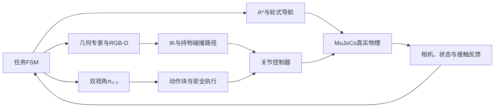

<div align="center">


# Robot VLA

**真实接触移动操作 · 几何规划控制 · 双视角 π₀.₅**

`Husky A200` · `Original UR5` · `Robotiq 2F-85` · `MuJoCo 3.6.0`

[技术总结](docs/TECHNICAL_REPORT.md) · [离线HTML报告](docs/TECHNICAL_REPORT.html) · [问题与解决措施](docs/PROBLEMS_AND_SOLUTIONS.md) · [视频演示](#视频演示) · [运行说明](docs/RUNNING.md) · [实验原始记录](evidence/)
</div>

## 项目概览

在同一个MuJoCo物理系统中完成门操作、十果分类、三书抽屉收纳，并将双视角π₀.₅接入正常机械臂执行器。传统导航/FSM与学习型短技能共存；没有通过物体瞬移、隐藏焊接或被动关节驱动伪造接触操作。

<table><tr><td width="33%"><b>移动与规划</b><br/>A*、外形膨胀、真实轮驱动、Dock与操作驻车</td><td width="33%"><b>接触与操作</b><br/>多初值IK、持物碰撞、推书侧抓、门臂协同</td><td width="33%"><b>视觉语言动作</b><br/>双RGB、实际状态、绝对关节动作、真实后训练与闭环推理</td></tr></table>

## 视频演示

点击封面查看或下载真实连续视频。前三项是完整传统任务开发演示，后三项是驻车指定目标抓起保持；VLA录像没有放置或完整十果分类。演示实例不替代下方固定评测。

<table>
<tr><td width="33%" align="center"><a href="media/demos/door_full.mp4"></a><br/><b>开门 · 入室 · 关门</b><br/>锁边把手 / Oracle / 宽门洞</td><td width="33%" align="center"><a href="media/demos/fruit_full.mp4"></a><br/><b>10果连续分类</b><br/>开发回合 / 全部正确入筐</td><td width="33%" align="center"><a href="media/demos/books_full.mp4"></a><br/><b>三书 · 三层 · 返航</b><br/>120/180/240mm长书本 / Oracle</td></tr>
<tr><td align="center"><a href="media/demos/vla_apple.mp4"></a><br/><b>π₀.₅ 苹果抓取</b></td><td align="center"><a href="media/demos/vla_banana.mp4"></a><br/><b>π₀.₅ 香蕉抓取</b></td><td align="center"><a href="media/demos/vla_orange.mp4"></a><br/><b>π₀.₅ 橘子抓取</b></td></tr>
</table>

[逐段评分与来源](media/index.json)。浏览器不支持直接播放时，可下载MP4后播放。完整材料下载：

- [traditional-cases70.zip](https://github.com/li2311675549/robot-vla/releases/download/v1.0.0/traditional-cases70.zip)
- [vla-cases30.zip](https://github.com/li2311675549/robot-vla/releases/download/v1.0.0/vla-cases30.zip)
- [technical-report-and-evidence.zip](https://github.com/li2311675549/robot-vla/releases/download/v1.0.0/technical-report-and-evidence.zip)

## 架构



VLA只学习驻车机械臂七维动作；门/抽屉约束控制与底盘导航保留传统方案。机身理想RGB-D与腕部虚拟RGB不是完整D435i物理传感器模型。门/抽屉和部分书本使用声明的Oracle几何，接触/容纳评分有仿真辅助。

## 关键问题与解决措施

|问题|采取的方法|实际证据|
|---|---|---|
|第三书仍夹住却被判滑移|世界向量改为工具坐标下的相对位移，原阈值保留|同一时刻旧误差25.032mm、新误差2.834mm；重新实抓续作完成|
|大书侧抓与柜体碰撞|先推后侧抓、有向几何抓点、真实净空上界、持物完整扫掠与已验路径执行|多个完整开发回合；冻结散落协议仍有失败|
|香蕉力大仍滚转|区分抓取闭合与保持闭合，接触/位姿反馈|seed420局部保持0.70完成0.381m倒车；漂移18.12→3.04mm|
|门操作重复重抓|底盘/机械臂圆弧协同、安全触发重抓、协调退出|同初态36→5抓，2144.86→462.336仿真秒|
|数据与执行不一致|高层绝对目标/reference/ctrl分开，train-only匹配chunk统计与双频物理重放|实际batch4/10000更新，9999完整保存重载与物理执行|

以上是相应局部/开发对照结论，不外推成全部场景成功率。[完整问题证据链](docs/PROBLEMS_AND_SOLUTIONS.md)。

## 评测结果

|协议|结果|成功回合平均仿真时间|边界|
|---|---:|---:|---|
|正常门完整任务|10/10|451.237s|冻结保留种子，Oracle，1.57m门洞|
|历史布局完整十果分类|2/10|1771.290s|3000s协议，RGB-D及仿真辅助验证|
|新散落三尺寸书收纳返航|4/10|1207.823s|冻结保留种子，Oracle|
|VLA十果桌面指定目标抓取保持|14/30|11.300s|6验证布局与预声明噪声，不含放置|

传统已执行水果抬升为53/57（苹果20/23、香蕉15/16、橘子18/18），含重试和提前终止，与完整任务分母不同。VLA固定验证按类为2/10、6/10、6/10。展示集按成功/失败数量整理，含重复初态和历史诊断，不用其构成估计独立成功率。

本发布目录实际通过258/258本地回归测试（97.29s），另有流式ZIP发布辅助测试1/1通过。日志随证据保存；后续只补文档与归档，不改控制或评分。模块测试、数据重放和loss下降都不等于完整任务通过。

## VLA数据与训练

- 输入：front/wrist RGB、实测六关节与夹爪、语言；不输入隐藏物体位姿。
- 动作：六关节高层绝对目标+夹爪，5Hz，10步chunk；内部32维填充。
- 实际训练：405片段、25517帧；旧单果20%/新多果80%加权采样。新十果数据为单目标抓取/放置，不是完整十果清空示教。
- 后训练：π₀.₅ LoRA配置，batch4、10000有效更新；最终checkpoint9999，validation flow loss0.01256467。
- norm：只用train，匹配采样和chunk；SHA `2315f953b3ee8949915f315b9c938ef6f0ca7a5e9397562d82c238d90b4c67c8`。
- 学习效果：已有真实抓取实例，尚未证明优于同条件专家或完成学习型完整分类。

[动作接口](docs/VLA_TECHNICAL.md) · [数据与训练](docs/VLA_DATA_TRAINING.md) · [实际服务器源码](server/snapshots/actual_training_20261108/)

## 快速运行

本地仿真使用Python3.10；服务器OpenPI使用独立Python3.11环境。不要把两套依赖混装。

```bash
# 在项目根目录，使用已安装的仿真环境
MUJOCO_GL=egl python -m pytest -q

# 新开发输出；不覆盖已有冻结正式结果
MUJOCO_GL=egl python scripts/run_stage7_isolated.py   --task door --mode oracle --seed 2101 --door-profile aligned_handles_v3   --config configs/door_continuous_contact_frozen_v4.json   --output outputs/new_door_demo --record
```

首次安装参考`requirements.lock.txt`、`environment.yml`和`scripts/setup_env.sh`。VLA推理/训练另需合法权重、Tokenizer、原始数据、对应GPU及独立环境，仓库不会自动下载或启动训练。

## 目录与复现

```text
src/robot_exam/   控制、导航、感知、任务FSM、数据和VLA
scripts/         构建、运行、评估、采数、训练、推理和资料导出
configs/         模型来源、场景、控制器与冻结协议
assets/ scenes/ third_party/   小型模型与原始许可
server/          实际训练源码、OpenPI、锁文件与norm快照
benchmarks/frozen/   三任务原冻结源码及164项SHA核验
media/           代表性连续视频、评分和来源
evidence/        原始统计与问题修复证据
docs/            最终技术总结、问题措施、运行说明
```

模型权重、完整训练数据、虚拟环境、缓存、认证信息和私有开发日记不在仓库中。第三方代码/模型遵循各自许可证；自研根许可证由作者另行确定。这里是MuJoCo仿真工程，不代表真实机器人部署结果。
