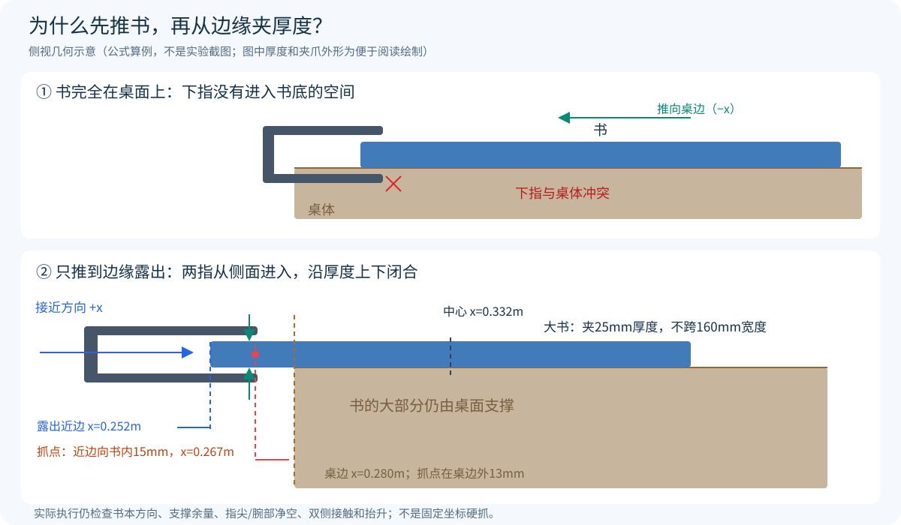

# 从图像到机器人动作：实现原理与决策流程

本文沿着感知、定位、规划、执行和反馈的顺序解释实现，结合代码与几何算例说明每一步如何衔接。

## 1. 先分清机器人在控制什么

|名称|含义|本项目中的例子|
|---|---|---|
|底盘位姿|底盘在地面上的位置和朝向`(x,y,yaw)`|先到书桌前，再到抽屉柜前|
|关节状态`q`|UR5六个关节实际角度，单位rad|肩、肘、腕的六维角度|
|末端位姿`(p,R)`|夹爪夹持参考点的位置和方向|到书边某一点，并使两指上下闭合|
|TCP|用于定位夹爪的参考点|源码中的`grip_pinch`，不是腕关节中心|
|高层动作|控制器下一步要达到的目标|六关节绝对目标+夹爪开合量|
|执行器控制量`ctrl`|实际送给MuJoCo执行器的命令|含限速和重力前馈的关节位置目标、轮速、夹爪指令|

位置回答“到哪里”，方向回答“以什么姿态接近”。同一空间点，夹爪从上方接近和从侧面接近，会对应不同关节解和碰撞关系。

**坐标约定：** 世界坐标固定在场景中，底盘坐标随车移动，工具坐标随夹爪移动。比较两个位置前先确认它们使用同一坐标系。

传统完整任务与当前VLA短技能具有不同的执行范围：前者用任务步骤调度器、规则和几何规划完成导航到操作终检；后者从已驻车桌面开始，只用图像、状态和语言生成抓起保持动作。当前没有把VLA接入完整任务调度，不控制底盘或入筐。二者复用正常执行器与物理接触。详见[系统与任务流程图](../README.md#架构)。

## 2. RGB-D怎样得到可操作的目标

### 2.1 RGB负责区分类别，Depth负责恢复距离

前方相机输出RGB和同视角深度。当前传统感知使用设定颜色的阈值分割：苹果红、香蕉黄、橘子橙；书本有不同封面色。连通域把相邻像素组合成候选物体，相邻像素深度差超过35mm时不继续连接，减少前后物体误并。

这属于适用于当前可控颜色场景的工程视觉基线，没有使用训练出的通用物体检测器。相近颜色、遮挡、反光和粘连仍会限制效果。圆形水果粘连分割有可选距离峰值分支，是否使用由对应回合配置决定，不能写成所有旧回合都采用。

### 2.2 一个像素如何变成三维点

设像素为`(u,v)`，其深度为`D`米，内参为焦距`fx,fy`和主点`cx,cy`：

```text
X_camera = (u − cx) × D / fx
Y_camera = (v − cy) × D / fy
Z_camera = D
p_world  = R_world_camera × p_camera + t_world_camera
```

前半段是反投影：把屏幕上的一个点沿相机射线还原到指定深度；后半段是坐标转换：把相机坐标中的点放回统一世界坐标。代码光学坐标为右/下/前，相对于MuJoCo相机坐标还做了轴向转换。焦距由虚拟相机视场角和图像尺寸计算，外参来自已知相机安装与机器人实际姿态。

因此“图像里在右边”与“世界坐标中x更大”不是同一个概念，尤其相机或底盘旋转后更不能混用。动作目标与机械臂正运动学必须在同一坐标系比较。

### 2.3 从一片点估计中心、尺寸和方向

将候选像素全部反投影后，只保留桌面上方和工作区内的点。当前代码取98%高度分位数作为顶面高度，并用靠近顶面的点估计轮廓：水果带宽5mm，书本3mm。XY参考中心用顶面坐标3%和97%分位数的中点，减少少量边缘异常点影响。

对顶面XY点做PCA（主成分分析）：点分布最伸展的方向作为长轴，垂直方向作为短轴；沿这两轴的投影分位数估计长宽。书本按`长×宽`排序，香蕉主轴用于让两指优先沿较窄方向闭合。PCA轴没有天然“正向”，因此姿态候选还要考虑反向和旋转分支。

这里输出的是**可见表面估计的操作参考**。高度中心用`(桌面高度+顶面高度)/2`近似，不是从图像精确恢复物体质量重心；遮挡时估计面积也不等于完整真实面积。

### 2.4 视觉、Oracle与评分分别用什么信息

|分支|用于产生动作目标的信息|需要明确的范围|
|---|---|---|
|传统水果vision|RGB-D类别、中心、方向，及筐的标识观测|物体ID/接触/容纳真值用于关联记录与验证，不覆盖视觉目标位置|
|书本vision接口|颜色、深度、PCA与估计面积|接口已实现，但当前大书推抓成功基线不是该分支|
|当前大书推抓Oracle（仿真真值专家）|书本实际中心、方向、尺寸与桌边几何|策略显式要求`mode=oracle`，不可描述成纯视觉自主侧抓|
|门/抽屉专家|已知门轴、把手和滑轨几何及实际关节状态|几何控制基线|
|VLA|front/wrist RGB、实测六关节+夹爪、语言、时间|不输入隐藏目标位置；接触/真值只供评测保护|

收纳筐通过颜色标识识别，再用已知偏移得到筐中心。底盘位姿来自仿真状态，障碍地图由场景定义提供；文字 OCR 与 SLAM 尚未实现。

## 3. 抓取位置和夹爪方向怎样确定

### 3.1 水果：围绕观测参考生成有限候选

传统专家的动作候选由规则生成，不是随机让手臂试碰：

1. 从感知结果得到类别、中心、长宽和主轴。
2. 生成主轴、反向和两种正交方向；香蕉还沿长轴偏移±10mm、法向偏移±6mm寻找邻近抓点，其他水果有小幅中心偏移。
3. 根据闭合方向计算要夹的宽度，超过78mm的候选直接排除。2F-85标称85mm，代码用78mm作为候选余量。
4. 预抓取点通常在抓点上方85mm。先检查预抓取与抓取的IK、关节余量和静态碰撞，再综合关节运动、开口宽度、误差与碰撞风险排序。
5. 苹果分支将估计参考点下调至多10mm，让有限长度指垫覆盖其较宽部位；这调整的是规划目标，不修改感知记录或物体位置。

当前候选评分是启发式几何评分，不是经过证明的抓取力闭合最优解。物理上是否夹牢，还要在执行后通过双侧接触、抬升和保持检查。

### 3.2 抓取参考点不等于物体几何中心

抓点决定指垫实际接触区域，末端姿态决定从哪里来和沿哪个方向闭合。对香蕉，沿全长夹持会超过开口或造成不合适接触；对书本，夹住边缘的厚度比跨越平面宽度更符合夹爪能力。

机器人控制的是`grip_pinch`目标，不是把机械臂腕心移动到物体中心。工具安装、指垫长度与参考点的偏移已经包含在机器人模型和IK中。

## 4. 为什么先推书，推到哪里，具体夹哪里

### 4.1 为什么直接夹桌面上的大书受阻

大书240×160×25mm的平面宽度超过夹爪开口，而25mm厚度可以夹。要上下夹住厚度，下指需要进入书底；书完全贴在桌面上时，下指没有进入空间。仅让TCP到达书边，并不能让腕部、指尖或相机支架穿过桌面。

因此动作链采用**先推移创造桌边净空，再侧向进入夹厚度**。推移是接触条件的准备，不是多余的搬动；也不是把整本书推落到桌外。

### 4.2 实际推移方向与停止条件

以下坐标属于当前书桌模型：桌面高度约0.725m，靠机器人一侧桌边为`x=0.280m`。Oracle专家读取书本实际姿态，从书的远侧（较大x一侧）用闭合夹爪推向近侧（−x）。

反馈推移以5mm指令增量前进，每步重新检查**实际书边位置**，最多80步。当前关键几何条件为：

- 目标近边到`x≤0.252m`后停止，即名义上露出桌边约28mm。
- 推移中书中心`x<0.282m`或中心高度跌到桌面以下触发失去支撑保护。
- 斜书用实际有向截面或符合条件的长边法向计算近边，避免用AABB角点代替真实书边。
- 推后再读取书姿态；推移引起转向时重新检查候选，不沿用推前方向。

这些是当前模型的几何阈值和反馈保护，不是质心始终位于支撑多边形内的完整稳定性证明。倾斜、过度旋转或跟踪失败仍按失败处理。

### 4.3 默认侧抓点：露出近边向书内15mm

设当前书中心为`c`。默认从世界−x一侧沿+x接近：

```text
h = 书本在通过中心的x方向直线上的真实半宽
p_grasp = [c_x − h + 0.015, c_y, c_z]
p_pre   = p_grasp − [0.075, 0, 0]
```

也就是选书本边缘中段、从近边往里15mm的夹取位置；预抓取位于它外侧75mm。向内15mm给指垫接触面积，预留75mm用于摆正夹爪后再直线进入。TCP目标高度使用实际书中心；夹爪接近轴水平、闭合方向竖直，形成上指压书面、下指托书底的夹持。

斜书的`h`按实际矩形中线截面计算：`min[(L/2)/|R00|, (W/2)/|R01|]`，忽略平放条件下的零投影方向；不是投影外包围盒半宽。程序还要求`p_grasp.x≤0.270m`，确保抓点在桌边外侧留出下指空间。



**公式算例，不是新实验：** 一种对齐姿态下半宽80mm，推后中心`x=0.332m`，近边为0.252m，抓点为0.267m；抓点位于书内15mm，也在0.280m桌边之外13mm。夹取的是该处25mm厚度，不是160mm整宽。

### 4.4 大书长边法向分支与回退

最大书优先尝试沿其长边的法向接近，便于后续将书长轴对准抽屉：令`n`为书本平面短轴方向，取其正x朝向，抓点为`c−n(W/2−0.015)`，预抓取为该点再沿`−n`后退75mm。

该分支要求短轴在x方向的半宽投影至少32mm。推后不满足条件时，启用已配置的中线侧抓回退，并继续检查碰撞和入屉路径，不强行沿不可用方向夹取。书本长短边朝向不是固定不变的，不能把一个示意图当作所有随机姿态的固定抓点。

### 4.5 从抓点到真实夹持

实际顺序为：推移后抬起推手→退底盘并张爪→到预抓取上方→经IK和关节路径降到预抓取位→前进75mm到抓点→闭合0.8秒→验证双侧接触→指令抬升100mm→检查实际抬升>55mm与保持状态。

书本保持检查采样0.6秒：双侧比例至少90%、工具坐标最大相对漂移<15mm，距离界限按书本半对角线+18mm计算。后续仍持续监控持物滑移；抓取成功没有免除运输和放置检查。

## 5. 底盘停在哪里：操作位姿选择

“底盘能到桌前”与“机械臂能完成动作”是两个条件。离目标太远会超出臂展，太近会造成肘/腕折叠、碰桌或关节接近限位。

操作位姿筛选在名义停靠点附近枚举小范围平移/偏航候选，在**独立规划数据**中放置候选底盘，依次检查预抓取、抓取或释放/退手等目标的IK与碰撞。可行候选按路径长度、关节运动量和限位余量排序。该评分是启发式，检查目标组随任务阶段定义，没有声称一次规划保证全部后续操作。

实际机器人不会被“放到”候选位置：选中候选后，先导航到预停靠位置，再由真实轮执行器Dock，最后根据**实际停止位姿**重新计算机械臂动作。规划副本中的假设位姿和运行中的物理控制必须分开。

## 6. IK怎样把夹爪目标变成六个关节目标

### 6.1 正运动学与逆运动学

正运动学用六个关节角计算夹爪在哪里；逆运动学反过来给定夹爪位置和方向，寻找六个关节角。对初学者可以理解为：目标指定“手放在书边并侧着夹”，IK负责分配肩、肘、腕该转多少。

源码根据MuJoCo雅可比矩阵计算当前位置/姿态误差对应的关节微调：

```text
Δq = Jᵀ (J Jᵀ + λ² I)⁻¹ e
```

`e`是末端误差，`J`描述关节小幅转动怎样影响夹爪，阻尼`λ`让接近奇异姿态时求解更稳定。实现对旋转项用0.35权重、阻尼0.002，并限制单次更新及关节边界；这些是现有求解设置，不是动力学接触控制器。

### 6.2 为什么需要多个初值

同一个末端目标可对应不同肘部或腕部姿态。求解从当前关节、参考、历史成功解和若干预设配置开始；对收敛解检查限位、路径碰撞和运动代价，排除撞桌或折叠不合适的分支。

精确IK收敛要求位置误差<0.5mm、姿态误差<0.003rad。已有近似返回分支明确标记位置<3mm/姿态<0.01rad；仍须经过实际运动到位检查。求解得到的`q*`只是目标，不是机械臂已经移动完成。

## 7. 轨迹和底层动作怎样生成

### 7.1 将两个目标之间的运动分成小步

- **笛卡尔移动：** 位置用`s=3t²−2t³`平滑插值（t是0到1的归一化进度），方向用四元数归一化线性插值；在2ms物理步长下，每20步（40ms）更新中间目标并求IK。
- **关节移动：** 六关节用同一个平滑进度同步插值，避免各关节独立限速后实际扫出另一条路径。涉及避障时先检查关节起终点之间的直接路径；受阻后用RRT（快速随机扩展树）采样可行关节姿态、扩展连接，再离散检查每段中间姿态。搜索不到安全路就失败退出。
- **执行：** 将高层关节目标经过参考限速和一次重力前馈，再写到位置执行器；车轮和夹爪命令在同一物理循环更新。没有把数值IK解直接赋给运行中的关节状态。

每段结束读取真实关节/TCP误差。笛卡尔移动还能用实测关节重求IK、有限时间继续收敛；超过容差则报跟踪失败，不因规划器已给出解就进入下一状态。

### 7.2 持物路径为什么还要单独检查

夹爪空着通过某个空隙，不代表夹着240mm长书也能通过。规划器在副本中记录当前工具到书的相对变换，将书随候选工具位姿更新，再检查“手臂、夹爪、支架、书”的扫掠。

运行中的书仍是自由物体，靠真实接触保持；该规划假设没有被做成焊接约束。执行采用已检查路段，防止另一次不考虑持物关系的规划覆盖已检验路径。离散碰撞检查不等于连续时间无碰撞证明，所以实际执行仍保留保护。

## 8. 任务步骤调度器如何决定底盘与机械臂谁动、何时一起动

调度器采用有限状态机（FSM）：把“导航、抓取、放置”等阶段称为状态，满足完成条件后转到下一状态。决策由它和几何规则完成：每个状态读取当前目标/反馈，调用对应技能，并按完成条件、超时与有限重试转移。传统完整任务没有由VLA或语言模型决定底盘路线。

|阶段|底盘做什么|机械臂做什么|如何协调|
|---|---|---|---|
|5m接近|A*路点跟踪、真实四轮驱动|收拢保持|减少行驶时的外伸与碰撞|
|桌面驻车操作|停靠并保持锚点|接近、推书、抓取或放置|启用驻车配置时，稳定2秒后允许动作；漂移保护不靠固定基座|
|水果转运|按载荷类别限速前进/转向|默认周期性IK保持工具世界方向|末端XY随底盘局部偏置移动，Z保持；不是让夹爪在世界位置完全不动|
|大书特定转运|低速移到柜前预停靠位|最大书可用关节姿态保持|大书不一律套用水果世界方向保持；抬高持物组件清除把手后再接近|
|门圆弧|沿门轴切向跟随|按实际门角跟踪把手|门角是共同进度变量；接触/误差不合格则暂停或安全释放|

独立VLA驻车实验不属于上表的完整任务调度状态：它只输出机械臂与夹爪目标，驻车伺服保持底盘，不接入导航或入筐。

### 8.1 水果转运中，底盘转了为何还要调整机械臂

固定关节角时，机械臂会随底盘转向，夹爪也一起转。默认水果运输每10个物理步（20ms）检查底盘姿态，按保存的底盘局部XY偏置生成新的世界目标：

```text
p_tool.xy = p_base.xy + Rz(yaw_base) × local_xy
p_tool.z  = 保存的搬运高度
R_tool    = 保存的世界方向
```

再用IK修正关节目标，保持工具方向而让位置随车走；遇到不可达或夹持异常立即停止。保存的方向、速度上限与实际夹持反馈共同约束搬运，不是底盘任意移动时机械臂都能无条件补偿。

### 8.2 门与书为什么采用不同协调方式

门把手受机构约束，底盘需要边动边维持接触；桌上书的推抓要求稳定支撑，通常先停稳再操作。书取出后进入转运状态，才能解除驻车并开往抽屉柜。进入下一操作状态再重新驻车。

驻车使用车轮编码器和底盘位姿误差反馈给真实轮执行器做小幅修正，不锁死自由基座；超出漂移保护条件就停止。

配置决定是否启用`stationary_manipulation`；不能把新版驻车保护说成所有历史传统水果回合都已启用。当前最大书的关节保持分支，是为避免强行维持世界方向导致不可达；书随车转动，柜前再按书轴生成重新对齐和入屉姿态，它仍有完整持物碰撞与滑移检查。

## 9. 一次三书任务的实际决策顺序

```text
保存起点 → 导航书桌 → 排序三本书
对最小/中等/最大依次循环：
    去柜前 → 抓把手拉开对应层 → 释放并退出
    回书桌 → 按当前书姿态推边/侧抓 → 检查抬升
    带书去柜前 → 检查持物净空和屉开度
    碰撞检查入屉路径 → 释放 → 退手 → 接触关屉
三书/三屉复核 → A*返回保存起点 → 独立评分
```

先开抽屉再拿书，是为了避免已占用的两指夹爪同时抓书和抓把手。实际屉开度在放置前仍要复核，防止运输中的接触把它推回。

水果任务则每次重新观察剩余目标，执行抓取、搬运、类别对应入筐和物理复核；当前目标选择是规则排序，不是全局最优旅行商规划。门任务按接近、外把手开门、整机过门、内把手关门和安全退手组织。

## 10. VLA怎样生成动作，和传统专家有什么不同

传统专家先得到几何目标，再经IK和轨迹生成关节动作。当前π₀.₅直接由前方/腕部RGB、实际六关节与夹爪、语言预测关节动作块，执行时不把隐藏目标坐标送入模型，也不在每个预测动作后额外跑几何抓取专家代替模型。

动作是六关节高层绝对目标+夹爪，按5Hz仿真节拍预测10步、执行1步（0.2秒），保留后续点用于插值后重新观测；关节限位、速度0.7rad/s及加速度1.4rad/s²由执行器接口检查。网络等待时仿真暂停，实机部署还需评估端到端推理延迟。

模型当前验证的是十果桌面中的指定目标抓起保持，不是导航或清空全部十件。完整传统任务、专家数据重放与学习模型闭环结果分别报告，不能用一种成功率替代另一种。

## 11. 源码阅读顺序

1. [感知与反投影](../src/robot_exam/perception/rgbd.py)、[分割/PCA/候选](../src/robot_exam/perception/objects.py)。
2. [操作底盘候选](../src/robot_exam/control/base_pose.py)、[IK与关节控制](../src/robot_exam/control/arm.py)。
3. [推书和抓点](../src/robot_exam/skills/book_edge.py)、[持物关节路径](../src/robot_exam/control/joint_rrt.py)。
4. [共享运行时/动作插值/协同](../src/robot_exam/tasks/runtime.py)、[三书任务](../src/robot_exam/tasks/drawer.py)、[水果任务](../src/robot_exam/tasks/fruit.py)、[门协同](../src/robot_exam/tasks/door_contact.py)。
5. [VLA接口](../src/robot_exam/vla/interface.py)、[评测](../src/robot_exam/vla/multifruit_evaluation.py)、[实际成功标准](IMPLEMENTATION_GUIDE.md)。

## 12. 与提交要求的对应关系

三个传统任务均有从起点执行完整流程的成功演示，交付视频与统计见[实验结果](FINAL_RESULTS.md)。本文说明实现方法，不承诺所有随机初态都完成。

传统方法复现所需源码、小型模型、许可证、依赖与运行命令随仓库提供。VLA完整权重、Tokenizer和原始训练数据未随GitHub发布，服务器快照和norm不等于完整模型；复现学习策略需要另行取得这些资产。具体入口见[运行说明](RUNNING.md)。

---

## 附录：任务成功标准与关键控制参数

本页说明完整任务、单物体片段和 VLA 指令抓取的判定条件。数值来自评分函数、控制器和回合配置。表中速度为指令上限或限速参数，实测速度见轨迹日志。

### 1. 开门、入室、关门

采用正常锁边双把手模型及`tangent_arc_v4`控制器。机器人从约5m起点导航，夹住外侧把手，轮式底盘与机械臂沿门轴圆弧协同开门，整机入室，再抓内侧把手关门并退出接触区域。

**完整成功需要同时满足：**

1. 开门与关门接触阶段均完成，门板由真实机器人接触驱动。开门目标角为1.56rad，关门目标角为0rad。
2. 关门前整机已跨过门平面：机器人碰撞几何的最小世界坐标`x`大于0.07m。
3. 最终门角绝对值小于0.035rad（约2.01°）。
4. 最终底盘`x>0.70m`，整机最小`x>0.07m`。
5. 最终底盘平面线速度小于0.02m/s、偏航角速度绝对值小于0.03rad/s。程序在最终清场后停止并继续仿真2秒，再读取末态。
6. 没有未处理的静态障碍碰撞、超时或仿真异常。

**接触阶段完成条件**比最终门角更细：开门角误差小于0.012rad、关门角误差小于0.010rad，实际门角速度小于0.015rad/s、工具跟踪误差小于12mm，并持续0.6秒。双侧接触丢失超过80ms、跟踪误差大于45mm，或超过25mm持续100ms时触发安全停止/释放和有界重抓，而不是强行继续拉门。

每阶段最多4次抓握尝试，单段圆弧最多180秒。该版本使用Oracle门轴/把手几何，门洞宽约1.57m。

源码：[door_contact.py](../src/robot_exam/tasks/door_contact.py)、[冻结门配置](../configs/door_continuous_contact_frozen_v4.json)。

### 2. 传统水果抓放与完整十果分类

苹果、香蕉、橘子使用相同的最终入筐标准，区别在抓取候选、保持闭合量和搬运速度。

#### 单水果成功

需有真实抓取/抬升证据，经过搬运、释放后，水果进入**自身类别对应的筐**，通过`correct_bin`检查。不能仅凭末端到达筐上方或松开夹爪认定成功。

评分使用水果碰撞几何的世界坐标包围边界`lower/upper`：

- 水平边界全部位于对应筐内部矩形内，水平数值余量为3mm。
- 最低点不低于`0.55−0.005=0.545m`，最高点不高于筐沿高度`rim_z+0.010m`；当前筐沿为0.69m，因此上界0.70m。
- 水果质心线速度小于0.02m/s。

当前筐内部水平半尺寸为95×90mm，即内部矩形190×180mm。这些是现有模型与评分坐标，不是重新制定的标准。

基础抓取技能先要求双侧接触；抬升指令为95mm，保持0.6秒后，实际抬升至少55mm且仍有双侧接触。进入载荷搬运后，以工具坐标系计算水果相对位移/转角；位移超过25mm、相对旋转超过0.35rad或双侧接触丢失，连续3个20ms检查周期出现即触发夹持保护。

#### 完整十果成功

从约5m起点出发，初始共10个水果、三类均出现，同类具有尺寸/外形差异；最终**10/10水果均通过各自正确筐的完整边界及低速检查**，并且整个流程无未处理碰撞、执行异常或协议超时。单水果片段只覆盖对应物体的操作，不单独覆盖5m导航和其他9个水果。

香蕉失败案例还包含一条明确标记的“已持物静态保持诊断”；其初始化及失败阶段可在附件评分来源中核对。

源码：[fruit_score](../src/robot_exam/tasks/scoring.py)、[抓放技能](../src/robot_exam/tasks/manipulation.py)、[任务FSM](../src/robot_exam/tasks/fruit.py)、[载荷监控](../src/robot_exam/tasks/runtime.py)。

### 3. 小、中、大书收纳与完整三书返航

三种书本为120×80×15mm、180×120×20mm、240×160×25mm。按长×宽的平面面积排序：96、216、384cm²，比例1:2.25:4；最小、中等、最大分别放第一、第二、第三层。源码rank为0、1、2。

#### 单书成功

对应层抽屉实际打开，书本经真实推移/抓取/抬升/搬运后释放在正确层内，退出夹爪并关闭该层。侧抓抬升需大于55mm；几何感知保持检查采样0.6秒，双侧接触比例至少90%、工具坐标相对漂移小于15mm，物体中心到工具距离小于“实际书本半对角线+18mm”。

#### 抽屉内判定

以该层当前实际滑动开度`q`及底板高度`b`计算，书本全部碰撞包围边界需满足：

```text
lower_x > 0.58 − q + 0.008
upper_x < 0.86 − q
lower_y > 0.31
upper_y < 0.69
lower_z > b − 0.003
upper_z < b + 0.14
书本线速度 < 0.02m/s
```

三层底板高度为0.34、0.53、0.72m。上述是现有模型世界坐标的评分公式；改变柜体布局时必须同步版本化，而不是直接套用坐标。

#### 完整三书成功

- 三本书都在对应层内且稳定。
- 三个抽屉实际开度绝对值均小于12mm。
- 机器人返回记录的初始位姿：平面位置误差小于0.10m，航向误差小于0.08rad。
- 流程没有未处理静态碰撞、执行异常或协议超时。

单书展示段覆盖该层开合与书本放入；返航属于完整三书父回合。大书的历史失败包含碰撞/几何拒绝和保护性停止；保护停止时仍夹着书，不等同于实际掉落。

源码：[drawer_score](../src/robot_exam/tasks/scoring.py)、[书本侧抓](../src/robot_exam/skills/book_edge.py)、[抽屉FSM](../src/robot_exam/tasks/drawer.py)、[冻结三书配置](../configs/stage20_books_scatter_frozen_v28.json)。

### 4. VLA按指令抓起并保持

当前视频与固定验证都从已物理驻车的十果场景初始化。指令示例：`Pick up the leftmost apple in the front camera image and hold it above the table.` 对香蕉/橘子更换类别名称；当前评分要求抓中该指令确定的具体目标，因此同类非最左物体也不算正确目标。

**成功条件同时成立：**

|项目|代码判据|
|---|---|
|目标|语言指定的具体水果；没有另一个水果在回合中被抬高55mm及以上|
|实际抬升|判定时目标相对初始化高度升高至少55mm|
|保持接触|有完整1秒接触记录，最近1秒至少90%的物理步存在左右指的目标双侧接触|
|末态接触|判定当下仍存在双侧接触|
|旁物保护|其他水果仍在原桌面支持范围内，判定时各自线速度小于0.02m/s|
|驻车|相对驻车锚点位置误差小于10mm、航向误差小于0.020rad，线速度小于0.020m/s、角速度小于0.030rad/s，最终稳定状态有效|
|时限|30秒仿真内达到成功；网络等待期间仿真暂停，单次响应预算2秒，总墙钟保护600秒|
|安全|无禁止静态接触、驻车故障、非法动作/非有限状态、执行或录像失败|

注意代码的准确含义：55mm是**判定时抬升高度**；最近1秒检查的是双侧接触比例，并未额外断言这1秒每一帧都高于55mm。驻车先有2秒实际稳定见证；运行中连续超过驻车包络100ms触发故障，结束时仍需`ready=True`且未fault。

VLA操作范围为指定水果抓起并保持，不包含入筐。

模型只接收front/wrist RGB、实际关节及夹爪状态、语言和时间。真值位置及接触只供独立评分，不是模型输入。源码：[VLA评分](../src/robot_exam/vla/multifruit_evaluation.py)、[旁物检查](../src/robot_exam/data/scene_quality.py)、[驻车监控](../src/robot_exam/control/parking.py)。

### 5. 底盘与导航参数

|参数/工况|设定值|说明与来源|
|---|---:|---|
|物理步长|0.002s|500Hz物理步进|
|车轮半径|0.1651m|差速轮速换算|
|左右轮距|0.555m|差速轮速换算|
|四轮目标速度限幅|±12rad/s|底层轮速指令限幅，不是任务行驶速度|
|A*栅格分辨率|0.08m|二维地图|
|障碍膨胀半径|0.64m|保守考虑整机占据|
|空载路径跟踪线速度|≤0.20m/s|TaskRuntime.navigate的直行分支；低层track方法默认0.25m/s不等于任务采用0.25m/s|
|空载导航角速度限幅|±2.0rad/s|转向或航向校正分支|
|普通水果载荷线速度|≤0.10m/s|已保存水果回合配置|
|普通载荷角速度配置|1.0rad/s|非香蕉载荷限幅；上游局部控制可能更低|
|香蕉载荷线速度|≤0.05m/s|已保存水果回合配置|
|香蕉普通转运角速度配置|0.035rad/s|不是所有阶段的硬上限；纯转向克服侧滑分支可升至0.45rad/s|
|普通/香蕉轮速变化率|0.8 / 0.20rad/s²|载荷模式四轮目标渐变|
|普通载荷转向缓行配置|0.035m/s|仅特定非精密转向分支；精密Dock不无条件注入|
|三书新版持书线速度|≤0.06m/s|新版配置；资料包中历史大书失败回合也有0.10m/s版本|
|三书带载Dock角速度配置|0.9rad/s|上游精密控制、限速和变化率仍会约束实际命令|
|门圆弧参考角速度|0.020rad/s|随接触、误差和实际门角反馈暂停/减速|
|门臂协同底盘指令限幅|线速度±0.075m/s；角速度±0.85rad/s|不是门板自身角速度|
|门臂协同轮速变化率|1.2rad/s²|圆弧控制分支|
|门清场线速度|−0.06m/s|保持朝向向室内退行，随后停止|

差速换算：`ω_left=(v−ω·0.555/2)/0.1651`，`ω_right=(v+ω·0.555/2)/0.1651`，同侧前后轮使用相同目标；实际运动允许轮地侧滑，因此目标值不能替代实际轨迹测量。

Dock通用默认位置容差23mm；门前接触Dock为30mm、内侧25mm等**调用级容差优先**。通用严格到位还要求航向误差小于0.035rad、实际线速度小于0.02m/s、角速度小于0.03rad/s，并在到位条件下稳定2秒。导航阶段的55/85mm路点切换半径不是最终放置Dock精度。

源码：[底盘](../src/robot_exam/control/base.py)、[导航/Dock/载荷](../src/robot_exam/tasks/runtime.py)、[栅格](../src/robot_exam/navigation/grid.py)、[基础配置](../configs/task_defaults.json)。

### 6. 机械臂、夹爪、VLA执行与时间协议

|参数|数值及适用范围|
|---|---|
|传统机械臂参考限速|普通0.7rad/s；载荷模式配置1.2rad/s；同步关节轨迹还按0.7rad/s尺度延长时长，不能视为每段都跑到1.2|
|关节运动结束检查|最大关节目标误差≤0.06rad|
|默认笛卡尔到位容差|18mm；门预抓取/接触等调用可用12mm|
|IK精确收敛|位置误差<0.5mm，姿态误差<0.003rad|
|IK已有近似返回分支|迭代后位置<3mm、姿态<0.01rad时显式标记approximate；不替代实际轨迹到位检查|
|重力补偿|位置执行器内单次前馈，等效目标偏置限幅±0.08rad；不在模型动作中再次补偿|
|夹爪归一化指令|0=打开，1=闭合；映射执行器ctrl=255×closure|
|传统水果保持闭合|成功展示来源苹果有0.55/0.70、香蕉有0.65/0.70版本；0.70不是70N，也不保证实际接触力固定|
|VLA执行参考限速/加速度|0.7rad/s、1.4rad/s²|
|VLA控制语义|6轴绝对高层关节目标（rad）+归一化夹爪；reference、ctrl另存|
|模型预测与执行|5Hz；预测10步chunk，每次执行1步0.2秒并利用后续预测插值，再观测重规划|
|VLA输入图像|实际front/wrist两路RGB，网络接口224×224；缺失第三相机用mask声明|
|完整任务协议时间|所列传统开发/冻结正式回合为3000仿真秒/3600墙钟秒|
|旧默认时间配置|task_defaults仍是1600/1800，运行上述协议必须加载相应覆盖配置；原题没有1600秒硬时限|

物理状态非有限或MuJoCo `data.warning`计数非零由`Simulation.check()`报错。独立进程文本中的求解器提示与`data.warning`分别记录；后者为0不等于从未出现文本提示。静态碰撞监控对墙、门框、柜体、桌腿及特定桌面/导航门板接触分类，进入禁止接触且穿入超过1mm记录事件；其他碰撞类型仍需补充监测。

参数来源可复查[按展示来源提取的参数摘要](../evidence/task_parameter_sources.json)。默认值、配置覆盖、阶段控制限幅和实际速度是不同层次；上述文档不将它们混为一个全程恒定参数。

### 当前提速演示配置（显式选择，旧基线参数保留）

|参数|门 speed_v2|水果 speed_v2|三书 speed_v2|
|---|---:|---:|---:|
|空载巡航请求上限|0.8m/s|0.8m/s|0.8m/s|
|带载平移上限|门接触弧另控|0.35m/s，末段操作接近≤0.25m/s|0.25m/s|
|自由关节参考上限|2.2rad/s|1.6rad/s|2.8rad/s，接触阶段另限|
|带载关节参考上限|1.6rad/s（非门弧速度）|1.4rad/s|1.8rad/s|
|门角参考上限|开0.20/关0.15rad/s|不适用|不适用|

配置为configs/door_speed_v2.json、fruit_speed_v2.json、books_speed_v2.json；逐阶段参数见motion_phase_profiles。控制请求不等于真实机体速度。实际轨迹按计划与低层限速最小值执行；不增加物体摩擦或执行器力限、不修改评分。完成时间使用实际记录，内部提速探索目标与物理成功评分分开。

### 物理模型参数补充

| 部件/场景 | 当前实现参数与依据 |
|---|---|
| Husky | 四轮自由基座，轮半径0.1651m、轮距0.555m；速度执行器`kv=60`，轮速±12rad/s、力矩±60Nm；源尺寸/惯性取自Husky描述 |
| UR5 | 六轴；肩高0.089159m、上臂0.425m、前臂0.39225m；前三轴力矩界±150Nm、腕轴±28Nm；详细惯性以资产XML为准 |
| 2F-85 | 复用四连杆/联动夹爪及真实指垫接触；按归一化闭合命令控制，不通过吸附附着物体 |
| RGB-D | MuJoCo理想RGB和米制深度、内外参、反投影；并非完整D435i双目/IR/IMU和噪声模型。腕部是额外虚拟RGB视角 |
| 门 | 正常锁边同轴双把手；门板1.56m宽、2.0m高、18kg；门洞净宽1.57m；铰链0–1.65rad、阻尼0.75、摩擦损失0.30；宽门协议局限需保留 |
| 水果 | 全任务10件：苹果4、香蕉3、橘子3，类别顺序随机；scale0.88–1.08；苹果复合椭球约0.126kg、橘子椭球0.12kg、香蕉三段胶囊0.09kg |
| 桌面与筐 | 桌高0.725m；三类独立有碰撞边界的标识筐；筐内半宽0.095×0.09m、边缘高0.69m。旧网格微扰与新版散落布局分别版本化 |
| 三书 | 120×80×15、180×120×20、240×160×25mm；主体质量0.15、0.30、0.50kg（另有0.001kg视觉书页）；按长×宽面积排序 |
| 抽屉 | 三个被动滑轨，行程0–0.27m，阻尼2、摩擦损失0.5；真实把手、底板、侧壁与释放净空 |

参数来源：`scripts/build_stage2.py`、`scripts/build_tasks.py`、`assets/ur5/ur5.xml`；各冻结配置可能额外定义安装/碰撞/控制参数，不能用上表替代完整配置。
