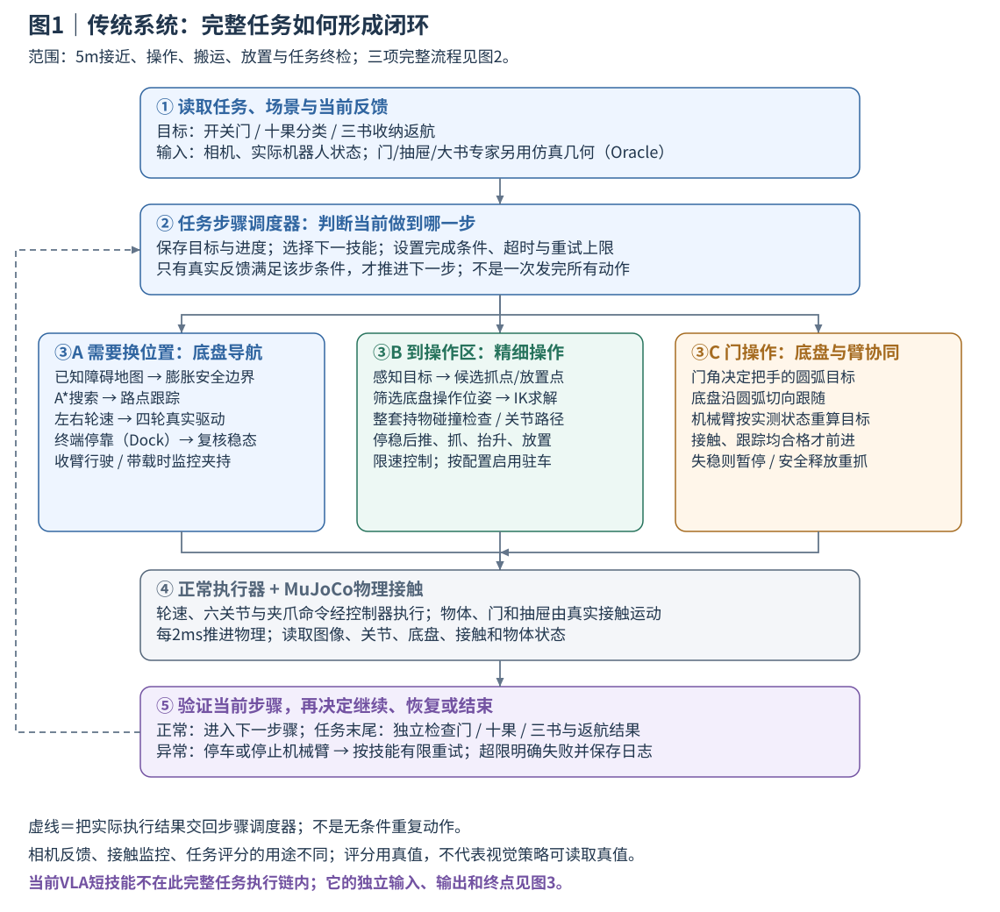
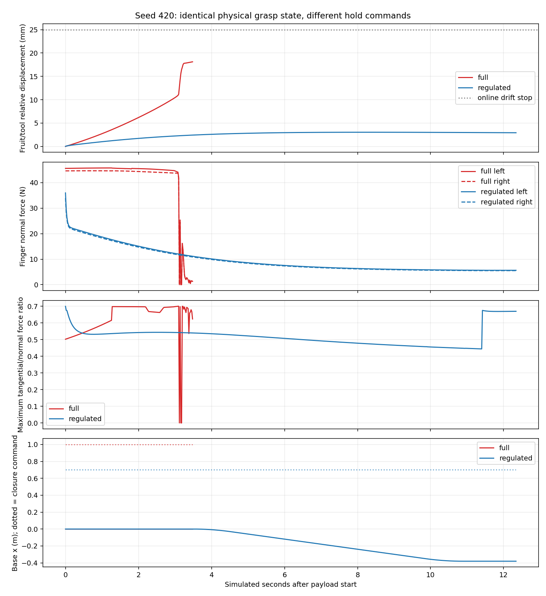
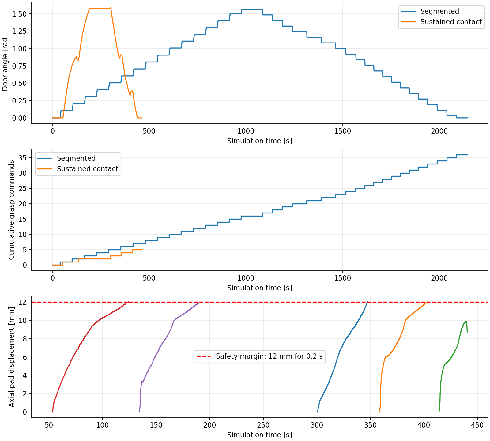
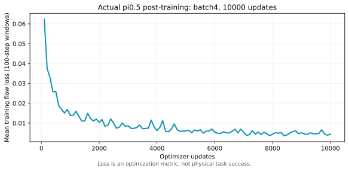

# 移动机械臂仿真与 VLA 操控技术总结

## 摘要

本项目在 MuJoCo 中搭建 Husky A200、原版 UR5、Robotiq 2F-85 与双视角相机组成的移动操作平台，围绕开门入室、十果分类和三书收纳开展实验。导航与任务状态机组织完整流程，几何规划、逆运动学和接触反馈完成抓取与搬运。

开发重点是处理多步操作中的具体失败：将滑移检测改到工具坐标系，消除持书转向时的误报；通过推边侧抓和持物路径检查解决大书操作空间不足；调整香蕉保持闭合量；通过底盘与机械臂协同减少门操作中的重复抓握。三个传统任务均已有完整成功演示。

在传统系统与示教数据基础上，进一步训练双视角 π₀.₅，验证驻车状态下按语言指令抓起指定水果并保持。[视频结果](FINAL_RESULTS.md)汇总最终交付案例。本文重点讨论故障定位、方案选择和仍需解决的问题。

## 1. 任务目标

|任务|完整动作链|整轮成功条件|
|---|---|---|
|门|门外约5m接近→抓把手拉开→整机通过→内侧关门|进入房间且门关闭、停稳|
|水果|距桌约5m接近→随机10果连续抓放|三类均出现、同类几何有差异，全部正确入对应标识筐|
|书本|距桌约5m接近→面积排序→三层收纳→关闭→返航|三书分别正确入屉，抽屉关闭，机器人回到初态容差内|

任务运行通过轮速、机械臂和夹爪执行器驱动，门、抽屉与物体受接触力作用。整轮任务、单件操作和检查点续作分别保存结果，便于定位多步流程中的失败。

## 2. 平台建模与设计依据

本地Python3.10、MuJoCo3.6.0；服务器OpenPI为独立Python3.11环境。物理步长0.002s，implicitfast积分、椭圆摩擦锥。机械臂采用原版 UR5 连杆参数。

|对象|关键参数与实现|
|---|---|
|Husky|四个真实轮关节/速度执行器、自由基座；轮半径0.1651m、轮距0.555m；惯性与尺寸由原描述适配|
|原版UR5|肩高0.089159m、上臂0.425m、前臂0.39225m；六轴位置控制、限位与力矩界|
|2F-85|联动四连杆与真实指垫接触；候选抓取保留有效开口约78mm，书本夹持厚度而非强行夹跨整本宽度|
|相机|机身理想 RGB-D、腕部虚拟 RGB；具备内外参和反投影，D435i 双目、IR、IMU 及噪声待扩展|
|门|锁边同轴双把手；门板1.56m×2.0m、18kg，净门洞1.57m；被动铰链0–1.65rad|
|水果|苹果复合椭球、香蕉三段胶囊、橘子椭球；十果4/3/3随机摆放，scale0.88–1.08|
|三书|120×80×15、180×120×20、240×160×25mm；主体质量0.15/0.30/0.50kg，按平面面积排序|
|抽屉|三独立被动滑轨、0–0.27m行程，真实把手、底板、侧壁、关屉接触|

三书平面面积比为 1:2.25:4。早期还探索过 A4/A5/A6 尺寸，相关失败保留在对应记录中；后续三尺寸在评测前固定，跨尺寸结果分别比较。模型来源见 `configs/model_sources.lock.json`，第三方许可见 `third_party/`。

## 3. 分层感知、规划与控制

传统系统承担完整任务；VLA 目前作为独立驻车抓取实验，复用底层执行器。

导航使用外形膨胀后的二维占据栅格、A*搜索与路点跟踪。差速映射为`ωL=(v−ωb/2)/r`、`ωR=(v+ωb/2)/r`；Husky可滑移转向，不能直接横向平移。

RGB-D 使用颜色连通域、深度反投影和 PCA 方向估计生成几何候选。门、抽屉和部分书本策略使用仿真几何信息（Oracle），执行判断结合仿真接触与容纳信息。

机械臂采用MuJoCo雅可比DLS IK、多初值及历史解搜索，检查关节余量、碰撞和连续性；实际关节运动经过限速参考与一次重力补偿。持物路径不仅检查末端和机械臂，还传播真实书本偏移检查整个扫掠体。规划在独立运动学副本中更新持物位姿，实际执行时书本仍由夹爪接触支撑。

FSM定义导航、观察、选择、规划、接近、抓取、搬运、放置、验证、恢复、返航、成功与失败状态。每状态有超时、物理判定及有限重试；失败原始类别需穿透上层异常包装，避免恢复分支失效。

## 4. 大书：从频繁失败到可完成的操作链

### 4.1 先区分不可达、执行偏差和碰撞

早期约67.4mm跟踪误差发生于下降阶段；数值IK收敛并不代表物理轨迹可执行。A4侧抓候选曾有腕/掌与桌面约41.7mm穿入，因此正确拒绝。增加长短轴候选只能补齐姿态搜索，不能消除几何冲突。

采用的措施是：从桌面上方直接下抓改为真实推移到边缘，再沿书厚侧夹；调整操作底盘位姿；预抓取到位确认；检查腕部、相机支架、桌面和夹爪退出空间。侧抓方案利用书的厚度和桌边空间获得可行抓点。

### 4.2 修复“仍夹着书却异常停止”的坐标系错误

旧滑移量直接比较世界坐标向量：`||(p书−p工具)(t)−(p书−p工具)(t0)||`。工具旋转时，刚性夹持也会改变该向量，产生假滑移。

修复使用工具局部坐标：`p局部=R工具ᵀ(p书−p工具)`。原25mm/0.35rad及连续三次异常规则保留，双侧接触检查保留。在原触发点，同一回合旧量25.032mm、新量2.834mm，双侧接触为真，直接证实坐标系误报。

修复后越过原中断点，后续又暴露出导航超时、书撞前板和把手、抽屉提前关闭等问题，需要继续处理。第三书重新实抓的连续续作最终成功：抬升92.045mm，最大工具坐标漂移2.839mm，双侧比例1.0，第三屉最终开度9.317mm，返回误差约64mm/30.4mrad。该回合从检查点开始，验证了第三本书操作及返航。

### 4.3 解决柜体净空、抓点与持物路径

- 运输高度按抽屉前板、凸出把手及支撑的真实碰撞上界加40mm，而不只按前板高度。放置前重新确认实际开度，防止对已被书推闭的抽屉释放。
- 斜书的AABB前沿不等于实际中线截面；曾导致抓点在书外约13mm。改用书本有向几何计算截面，并保留支撑和桌边净空判据。
- 针对中书，约30°夹爪倾斜和接触高度0.755m解决部分推移不可达；每个物理步检查桌面穿入。
- 碰撞搜索加入持物完整扫掠。预检后的路径不再被“不考虑移动书本”的普通规划器二次替换，采用正常关节插值执行已检验路段。

这些措施带来了多次真实完整三书开发成功，例如200007/200008/200009三个开发回合约1210.074/1210.288/1206.054s。该历史冻结散落协议记录为4/10：五次推书跟踪失败、一次持书路径碰撞预检失败。完整流程已打通，后续重点仍是随机推移和狭窄空间路径。

证据：`evidence/issues/third_book_fix.json`、`book_geometry.json`、`book_swept_path.json`、`books_formal_summary.json`。

## 5. 香蕉：为什么大法向力仍会失稳

旧失败轨迹在失去接触前仍有约45/44N法向力，夹持仍未保持稳定。局部低速倒车实验中，臂目标误差和底盘加速度很小，但香蕉相对工具持续漂移、滚转，接触切/法向比接近摩擦边界。这些现象提示应优先检查曲面接触布局和持续挤压的影响。

排查尝试保留了多候选、降低抓取高度、低速、摩擦试探等失败结果。提高摩擦或继续降速未解决原满闭合问题，后续转向保持闭合量与接触状态的检查。

采用“建立抓握后调节保持闭合量”、接触与相对位姿反馈、平滑限速、有界停止复核。seed420 的局部对照如下，两次使用相同模型物理参数：

|局部保持/倒车实验|满闭合1.0|保持0.70|
|---|---:|---:|
|局部结果|保持阶段失败|通过约0.381m倒车|
|最大相对位移|18.120mm|3.038mm|
|最大相对旋转|0.15879rad|0.03992rad|
|录像范围|已持物初态，3.6s|已持物初态，12.4s|

两次实验从已持物初态开始，持续时间和运动过程不同。局部结果支持保持控制的作用；复杂转弯中仍有失败，需进一步比较接触点、抓取深度和路径动态。

证据：`evidence/issues/banana_full_closure.json`、`banana_regulated_hold.json`及原始接触轨迹。失败保护有时在接触完全丢失前触发，具体停止原因见各回合评分。

## 6. 门：用底盘和机械臂协同减少无效重抓

早期门把手几何不符合常见锁边结构，后续改为两侧同轴锁边把手，并单独冻结新协议，不沿用旧几何的统计。

原控制把圆弧切成许多固定小段，每段释放、收臂、Dock、重抓。改为同时参数化底盘与把手圆弧：`p底盘(θ)=p门轴+Rz(θ)[法向偏置,切向偏置]`，底盘沿可执行方向运动，机械臂用实测底盘和门角修正末端轨迹。

正常阶段持续闭合；仅在指垫边缘余量、接触丢失、跟踪误差、载荷或碰撞条件触发时，停车、卸载伺服储能、释放、复核并有界重抓。释放后以实际位姿重新选择剩余可行圆弧，不强制返回过时理论Dock。最终张爪同时沿门法向退手45mm，减少擦碰回弹。

|同seed2101完整物理任务|原分段方案|协同持续抓握|
|---|---:|---:|
|执行器真实闭合边沿数|36|5|
|仿真时间|2144.860s|462.336s|
|完整评分|通过|通过|

同初态完整任务对照中，夹爪闭合次数减少约 86%，仿真耗时减少约 78%。正常门协议的种子 96001–96010 均完成，平均耗时 451.237 s。当前条件为 1.57 m 门洞和 Oracle 门轴、把手几何；窄门与视觉定位需要进一步验证。

证据：`evidence/issues/door_contact_acceptance.json`、`door_efficiency_comparison.json`。

## 7. 其他重要问题与工程处理

### 7.1 Dock终端振荡

位置误差跨越约23mm阈值时，追位置和调航向反复切换；载荷模式还可能把纯转向改成缓行。该控制器采用位置与航向反馈，问题集中在模式切换。

措施包括状态滞回、精密Dock与载荷运输分离、轮速变化限制、实测速度加连续2s稳态判定、局部预停靠及运动原语尝试。已有报告记录空载对照由 1/10 改善到 10/10、带载由 1/10 改善到 6/10，逐回合原始对照仍待补齐。困难横向工况仍有失败；部分局部路径方案在相同预算下未带来提升，因此没有设为默认方案。到位容差保持不变。

### 7.2 水果在机器人未接触时自行滚落

隔离实验中机器人停在5m外，旧场景苹果180s仍落桌，说明该例不是机械臂碰落。复合水果直立初态没有自然静力稳定姿态。新协议在独立标定台真实静置600s，提取稳定姿态用于新MJCF初始化；运行中的物体保持原质量与摩擦参数。新同参数场景静置1800s，十果均留桌、最大中心位移约0.4545mm。这一修改改变了初始分布，因此采用新协议单独评测。

### 7.3 腕部图像近裁剪与渲染来源

默认近面约66.71mm，苹果距腕相机约76.12mm而前表面越过近面，图像出现被裁空心轮廓。新虚拟观察版本将near设5mm，并记录真实NVIDIA/Mesa渲染器；物体几何、惯性、碰撞和相机位姿不变。已有动作经正常控制器重放生成新双视角，新旧视图分别保存，并关联同一场景来源。5mm只是理想渲染近面，不代表真实D435i最短测距。

### 7.4 异常归类与动作语义

上层导航曾把`gripper_slip`包装成`path_planning`，使重抓恢复无法触发。修改为仅对导航自身错误重规划，夹持、IK、超时保留原类别。

数据早期混有高层目标、限速reference和实际ctrl。Schema3统一监督六轴高层绝对目标+夹爪，其他量独立记录；观测/动作时刻、插值和执行器重放显式校验，避免归一化正确但控制语义不一致。

## 8. VLA训练与闭环执行

输入为机身RGB、腕RGB、六轴实际关节+夹爪状态和语言；缺失右腕视角用mask=false。隐藏物体位置不进入模型输入。深度用于专家/分析，不直接当原生四通道输入。

动作是`ur5_absolute_joint_goal_v1`，七个有效通道；模型内部保留32维、10步动作块、5Hz。执行器做关节界、速度/加速度约束及一次重力补偿，每个动作前缀执行后重观测。当前显式bounded_projection_v1仅投影夹爪小幅越界，严重异常仍拒绝。

实际训练405片段/25517帧，旧单果121片段、新3果32、新5果70、新10果182；十果对应91次单目标父操作和34个训练布局，不是91次完整清空十件。旧20%/新80%加权采样，十果预期采样质量约51.25%。训练/验证/测试按场景隔离；norm只用train，动作统计匹配10步chunk和尾部clamp。

训练batch4、10000有效更新，warmup500，学习率2.5e-5→2.5e-6；最终检查点 9999 已保存，并通过重新加载检查。两段训练墙钟合计约2.71h，最终验证flow loss0.01256467。模型表现另通过闭环抓取评测。

历史十果桌面固定验证：苹果2/10、香蕉6/10、橘子6/10，共14/30，涉及6个验证布局与预声明噪声，未用正式test。当前验证只要求指定目标抓起保持，不包括放置、5m导航或完整十果FSM。最终选取视频见下一节。

## 9. 最终交付视频与历史证据

|方法|操作内容|成功/记录|视频包内成功占比|
|---|---|---:|---:|
|传统|完整开门、入室、关门|10/10|100%|
|传统|苹果抓取与放置|10/10|100%|
|传统|香蕉操作|9/10|90%|
|传统|橘子抓取与放置|10/10|100%|
|传统|小书收纳|10/10|100%|
|传统|中书收纳|10/10|100%|
|传统|大书操作|7/10|70%|
|VLA|苹果抓起保持|9/10|90%|
|VLA|香蕉抓起保持|7/10|70%|
|VLA|橘子抓起保持|9/10|90%|

以上统计来自最终交付的传统70条、VLA30条视频及配套评分。记录经选取，含重复初态；传统包还含不同开发版本。水果和书本主要为单项片段，香蕉和大书分组包含局部失败诊断，VLA不含入筐。视频包内占比不替代完整任务独立评测。

[结果说明与来源](FINAL_RESULTS.md)。统计范围以各项视频说明为准。

最近保存的代码测试记录为 259 项通过，耗时 96.85 s，详见[测试记录](VALIDATION.md)。

## 10. 局限与后续工作

目前已建立三个完整任务的仿真流程，并针对坐标误报、夹持保持、门臂协同和持物路径开展了改进。完整任务的可靠性仍受带载停靠、随机推书跟踪和狭窄空间通行限制。门与书本依赖 Oracle 几何，相机为理想模型，实机部署尚待验证。

VLA 目前覆盖指定目标抓起保持。下一步先在相同初态下比较专家与模型，检查目标选择、接近、闭合和有效抬升，再补充接触及纠错示教，逐步扩展到放置。新策略固定后使用未参与调参的布局评测，并保留全部回合结果。

## 11. 代码与延伸阅读

核心模块位于 `src/robot_exam/`，任务入口为 `scripts/run_stage7_isolated.py`；VLA 训练、服务和评估入口分别为 `openpi_ur5_train.py`、`serve_openpi_original_ur5.py`、`evaluate_multifruit_policy_phase.py`。

- [运行说明](RUNNING.md)：环境安装、任务命令和历史协议。
- [实现解析](IMPLEMENTATION_GUIDE.md)：感知、抓点、逆运动学与轮臂配合。
- [设计依据](DESIGN_REASONING.md)：坐标系、持物路径、接触力矩和动作语义。
- [问题与改进](PROBLEMS_AND_SOLUTIONS.md)：诊断过程与实验记录。
- [成功判据与控制参数](SUCCESS_CRITERIA_AND_PARAMETERS.md)：各任务的判定条件。

仓库包含源码、小型模型、依赖、文档和代表视频；VLA 完整权重、Tokenizer 与原始训练数据需另行准备。
