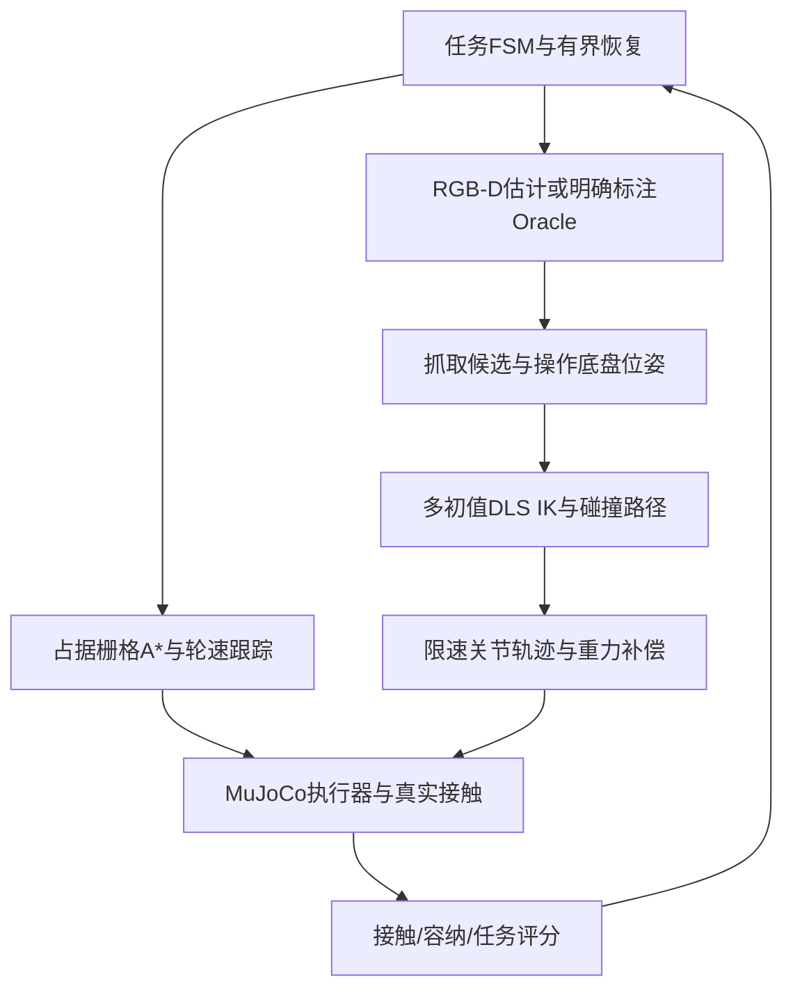

# 传统移动操作：建模、算法与实现

本文介绍传统系统的模型、控制和任务流程。视频结果见[成果汇总](FINAL_RESULTS.md)。

## 系统与物理模型

系统采用 Husky A200、原版 UR5、Robotiq 2F-85、机身 RGB-D 与腕部虚拟 RGB 相机。UR5 使用原版连杆参数，不是 UR5e。MuJoCo 3.6.0、Python 3.10；步长 0.002s，`implicitfast`、椭圆摩擦锥。机器人碰撞、惯性及执行器保留在 MJCF 中。模型资源固定来源和许可见源码 `configs/model_sources.lock.json`、`third_party/` 与各资产许可证。

| 部件/场景 | 当前实现参数与依据 |
|---|---|
| Husky | 四轮自由基座，轮半径0.1651m、轮距0.555m；速度执行器`kv=60`，轮速±12rad/s、力矩±60Nm；源尺寸/惯性取自Husky描述 |
| UR5 | 六轴；肩高0.089159m、上臂0.425m、前臂0.39225m；前三轴力矩界±150Nm、腕轴±28Nm；详细惯性以资产XML为准 |
| 2F-85 | 复用四连杆/联动夹爪及真实指垫接触；按归一化闭合命令控制，不通过吸附附着物体 |
| RGB-D | MuJoCo理想RGB和米制深度、内外参、反投影；并非完整D435i双目/IR/IMU和噪声模型。腕部是额外虚拟RGB视角 |
| 门 | 正常锁边同轴双把手；门板1.56m宽、2.0m高、18kg；门洞净宽1.57m；铰链0–1.65rad、阻尼0.75、摩擦损失0.30；宽门协议局限需保留 |
| 水果 | 全任务10件：苹果4、香蕉3、橘子3，类别顺序随机；scale0.88–1.08；苹果复合椭球约0.126kg、橘子椭球0.12kg、香蕉三段胶囊0.09kg |
| 桌面与筐 | 桌高0.725m；三类独立有碰撞边界的标识筐；筐内半宽0.095×0.09m、边缘高0.69m。旧网格微扰与新版散落布局分别版本化 |
| 三书 | 120×80×15、180×120×20、240×160×25mm；主体质量0.15、0.30、0.50kg（另有0.001kg视觉书页）；按长×宽面积排序 |
| 抽屉 | 三个被动滑轨，行程0–0.27m，阻尼2、摩擦损失0.5；真实把手、底板、侧壁与释放净空 |

参数来源：`scripts/build_stage2.py`、`scripts/build_tasks.py`、`assets/ur5/ur5.xml`；各冻结配置可能额外定义安装/碰撞/控制参数，不能用上表替代完整配置。

## 控制架构

### 导航、Dock与驻车

二维栅格按机器人外廓膨胀障碍物；A*使用距离代价与启发项搜索、回溯并压缩路点。反馈跟踪生成线/角速度，轮速为`(v∓ωb/2)/r`，左右各驱动两轮。真实滑移转向不能横向平移，困难横向终点与带载Dock仍有失败记录。

全局导航、终端Dock、操作驻车各自处理。终端控制包含状态切换、速度限制与局部路径尝试；驻车要求位姿与实际线/角速度持续稳定，并在机械臂执行期间监测漂移，仍由轮执行器保持，不焊接基座。桌面完整任务可在不同操作站间重新定位；VLA短技能使用驻车段。

代码：`navigation/grid.py`、`navigation/local_dock.py`、`control/base.py`、`control/base_pose.py`、`control/local_dock.py`、`control/parking.py`、`tasks/runtime.py`。

### 感知与机械臂

RGB颜色连通域/轮廓识别水果和标签，深度反投影得到三维位置，PCA估计主方向。相机外参转换到机器人/世界坐标。门、抽屉和部分书本策略使用仿真几何信息（Oracle）；执行判断还结合仿真接触与容纳信息。

DLS IK用MuJoCo雅可比更新关节，在独立scratch数据上搜索；多初值来自当前状态、历史解及合理分支，按关节余量、连续性与碰撞筛选。原求解器严格收敛与有界近似解分别记录，实际轨迹到位和最终任务判定独立。轨迹经限速参考、位置执行器及一次重力补偿执行。碰撞感知关节路径与采样搜索用于持书绕障。

代码：`perception/`、`control/arm.py`、`control/joint_path.py`、`control/joint_rrt.py`、`control/book_path.py`。

### 三任务动作链

- 门：约5m导航→把手预抓取→真实闭合→按铰链圆弧协同底盘/机械臂→门角与接触反馈→整机过门→内侧关门→停稳。仅在安全条件或阶段转换时有界释放/重抓。
- 水果：约5m导航→观测/选择→候选抓取与放置可达检查→真实抓抬→接触验证→带载转运与筐前Dock→释放/退出→容纳验证→重新观察，全部10件正确才整轮成功。
- 书本：约5m导航→面积排序→先拉开对应抽屉→回桌推书至边缘→侧夹厚度→持书避碰→复核屉开度→放书/释放/退出→关抽屉→三本完成后返航。先开屉再取书，避免夹爪持书后无法操作把手。

代码：`tasks/door_contact.py`、`tasks/fruit.py`、`tasks/drawer.py`、`skills/book_edge.py`、`tasks/manipulation.py`、`tasks/scoring.py`。

## 可靠性问题与已采取措施

大法向力不保证稳定夹持：香蕉会因接触布局、滚转和轨迹动态丢失双侧接触。已有平滑/低速搬运、滑移检测、候选姿态和有界恢复。Dock阈值振荡采用状态分离、稳态判定与局部运动路径缓解，但未全部解决。大书通过先推后抓、预抓取到位确认、持书碰撞路径改善；随机推移跟踪及狭窄路径仍限制完整可靠性。

运行中的物体、门和抽屉由接触力驱动。独立运动学副本用于规划求解，场景状态恢复用于初始化与离线验证。
