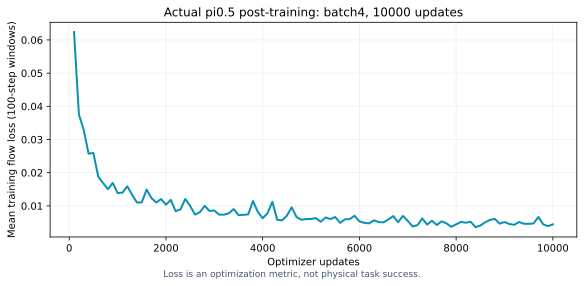
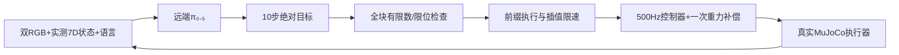

# VLA 数据与训练

## 数据组成

训练使用前方与腕部两路图像，以及对应的机器人状态、语言指令和动作。基础单果数据包含 173 条操作、17,646 帧；新增多果数据包含 204 次原始操作，拆成 408 个驻车片段、18,949 帧，覆盖 76 个场景上下文。

新增操作按场景分为训练 142 次、验证 28 次、测试 34 次。同一场景拆出的片段进入同一分区，避免相近布局同时出现在训练与测试中。

实际用于训练的片段如下：

|来源|片段数|帧数|
|---|---:|---:|
|原单果数据|121|12,342|
|三果场景|32|1,482|
|五果场景|70|3,245|
|十果场景|182|8,448|
|合计|405|25,517|

十果训练部分来自 34 个布局中的 91 次单目标操作，每次拆为抓取和放置片段。训练按旧单果 20%、新增多果 80% 加权采样，其中十果约占总采样权重的 51.3%。

## 动作标签与重放

Schema3 将学习目标统一为六轴高层绝对关节目标和夹爪闭合量。限速后的参考值、执行器命令、实测状态、深度图、阶段与时间戳另行保存，便于定位数据和执行问题。

观测与动作起点对齐，训练和推理均使用 5 Hz、10 步动作块。新增的 408 个片段通过高频及 5 Hz 控制器重放检查；失败轨迹单独保存，不进入成功示教集。重放检查用于确认数据能还原专家动作，模型效果由闭环抓取评测衡量。

## 归一化

统计只使用训练分区，并与实际加权采样保持一致。状态按采样起点统计；动作考虑 10 步动作块及片段末尾的重复填充值。π₀.₅ 使用分位数归一化，文件中同时保存 mean、std、q01 和 q99。

训练采用的[归一化文件](../server/assets/original_ur5/norm_stats.json)随服务器快照提供，可用于检查部署配置。

## 训练配置与记录

|设置|数值|
|---|---|
|模型|π₀.₅；Gemma 2B 与 300M action expert 的 LoRA 配置，训练参数由 freeze_filter 决定|
|批大小|4|
|更新次数|10,000|
|学习率|预热 500 步，余弦衰减，峰值 2.5e-5、末值 2.5e-6|
|动作|10 步，5 Hz，7 个有效通道，内部填充到 32 维|
|检查点|每 1000 步保存，保留 5000 与最终 9999|
|训练耗时|约 2.71 小时，不含中间验证与暂停|
|最后一批 loss|0.00151|
|末 100 步平均 loss|0.00443|
|最终验证 flow loss|0.01256|

训练记录包含连续的 10,000 次更新，最终检查点通过重新加载检查。损失用于观察拟合情况，物理抓取表现见[VLA 实验结果](FINAL_RESULTS.md)。

配置与实现：[训练配置](../configs/pi05_multifruit_stage22_batch4_v2.json) · [模型配置及参数冻结规则](../src/robot_exam/vla/openpi_config.py) · [服务器源码与依赖](../server/)

## 复现与下一步

本地 MuJoCo 使用 Python 3.10，服务器 OpenPI 使用独立的 Python 3.11 环境。仓库提供源码、依赖锁文件、数据说明和归一化统计；完整权重、Tokenizer 与原始训练数据未随仓库发布，复现时需另行准备。

接下来优先比较同初态下专家与模型的动作，区分目标选择、接近、闭合和接触保持的失败，再补充相应示教。进一步扩展到抓取后放置，并使用未参与调参的新布局评测。

---

## VLA：双视角动作接口与闭环执行

### 研究范围

当前模型是原版UR5的π₀.₅后训练策略，优先学习驻车桌面操作。最新录像验证的是十果桌面上按指令选中目标并抓起保持；没有验证VLA完整5m导航、连续清空10件与全部入筐。底盘导航、任务FSM、门/抽屉几何操作继续由传统模块承担。

### 输入和动作

| 项目 | 定义 |
|---|---|
| 图像 | front机身RGB、wrist腕部RGB；推理输入224×224，网络图像传输无损 |
| 状态 | 六轴实际关节角(rad)+归一化夹爪状态，共7维 |
| 指令 | 指定类别并按相机可见位置约定选择最左目标，具体文字保存在每回合结果中 |
| 学习动作 | `ur5_absolute_joint_goal_v1`：六轴高层绝对目标(rad)+[0,1]夹爪闭合量 |
| 另存诊断 | 限速后的`arm.reference`、实际`ctrl`与实测关节状态，不混作同一监督标签 |
| 动作块 | 10步×7有效通道，5Hz；模型保留32维内部填充，执行仅取前7维 |
| 相机槽 | `base_0_rgb`和`left_wrist_0_rgb`为真实模拟视角，缺失右腕槽以mask=false标记 |

输入接口只发送声明的图像、状态与语言，不发送隐藏目标真值。深度保留用于分析/专家定位，不直接拼成未经适配的四通道模型输入。

### 闭环执行

部署每次执行一个动作前缀后重新观测，保留整块以支持插值；不是先切掉后续预测再插值。低层默认速度/加速度界0.7rad/s、1.4rad/s²，精确值以执行接口及冻结协议为准。停车保护、异常动作拒绝、网络时限与有界任务超时均独立于模型。

当前评估显式使用`bounded_projection_v1`：夹爪小幅越界（最多0.10归一化行程）投影到[0,1]，严重越界/非有限仍拒绝。该处理只作用于夹爪指令，机械臂目标和评分保持原定义。

远端调用期间本地仿真暂停，所以仿真任务时间与网络墙钟时间分开记录。客户端持有本地物理执行和录像，服务器只负责动作预测。源文件：`vla/interface.py`、`client.py`、`policy_safety.py`、`multifruit_evaluation.py`、`scripts/serve_openpi_original_ur5.py`、`scripts/evaluate_multifruit_policy_phase.py`。

### 当前短技能成功条件

选对指令目标，真实抬升至少55mm；最后1秒双侧接触比例至少90%，结束仍双侧接触；停车、非目标物保护和碰撞检查通过。场景在开始时恢复初态，运行中通过夹爪接触完成操作；入筐放置尚未纳入当前评测。

分类视频、独立验证与统计范围统一见[实验结果](FINAL_RESULTS.md)。
