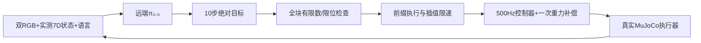

# VLA：双视角动作接口与闭环执行

## 研究范围

当前模型是原版UR5的π₀.₅后训练策略，优先学习驻车桌面操作。最新录像验证的是十果桌面上按指令选中目标并抓起保持；没有验证VLA完整5m导航、连续清空10件与全部入筐。底盘导航、任务FSM、门/抽屉几何操作继续由传统模块承担。

## 输入和动作

| 项目 | 定义 |
|---|---|
| 图像 | front机身RGB、wrist腕部RGB；推理输入224×224，网络图像传输无损 |
| 状态 | 六轴实际关节角(rad)+归一化夹爪状态，共7维 |
| 指令 | 指定类别并按相机可见位置约定选择最左目标，具体文字保存在每回合结果中 |
| 学习动作 | `ur5_absolute_joint_goal_v1`：六轴高层绝对目标(rad)+[0,1]夹爪闭合量 |
| 另存诊断 | 限速后的`arm.reference`、实际`ctrl`与实测关节状态，不混作同一监督标签 |
| 动作块 | 10步×7有效通道，5Hz；模型保留32维内部填充，执行仅取前7维 |
| 相机槽 | `base_0_rgb`和`left_wrist_0_rgb`为真实模拟视角，缺失右腕槽以mask=false标记 |

输入接口只发送声明的图像、状态与语言，不发送隐藏目标真值。深度保留用于分析/专家定位，不直接拼成未经适配的四通道模型输入。

## 闭环执行

部署每次执行一个动作前缀后重新观测，保留整块以支持插值；不是先切掉后续预测再插值。低层默认速度/加速度界0.7rad/s、1.4rad/s²，精确值以执行接口及冻结协议为准。停车保护、异常动作拒绝、网络时限与有界任务超时均独立于模型。

当前评估显式使用`bounded_projection_v1`：夹爪小幅越界（最多0.10归一化行程）投影到[0,1]，严重越界/非有限仍拒绝。该处理只作用于夹爪指令，机械臂目标和评分保持原定义。

远端调用期间本地仿真暂停，所以仿真任务时间与网络墙钟时间分开记录。客户端持有本地物理执行和录像，服务器只负责动作预测。源文件：`vla/interface.py`、`client.py`、`policy_safety.py`、`multifruit_evaluation.py`、`scripts/serve_openpi_original_ur5.py`、`scripts/evaluate_multifruit_policy_phase.py`。

## 当前短技能成功条件

选对指令目标，真实抬升至少55mm；最后1秒双侧接触比例至少90%，结束仍双侧接触；停车、非目标物保护和碰撞检查通过。场景在开始时恢复初态，运行中通过夹爪接触完成操作；入筐放置尚未纳入当前评测。

最终交付视频包包含30条驻车抓取保持记录，苹果9/10、香蕉7/10、橘子9/10，口径见[最终结果](VLA_RESULTS.md)。它是含重复初态的选取集合，不是新一轮独立评测。
